# Entregables 1–10: estado y verificación

Todo se probó en macOS 26.5 (Apple Silicon, pantalla de 120 Hz) contra el servidor L1J-JP 3.63c
local (`servidor_local/`), con la instalación de Lineage Justice. Las capturas están en
`docs/capturas/` y se generaron con las opciones de automatización del README.

## Entregable 1: Pantalla de login ✅

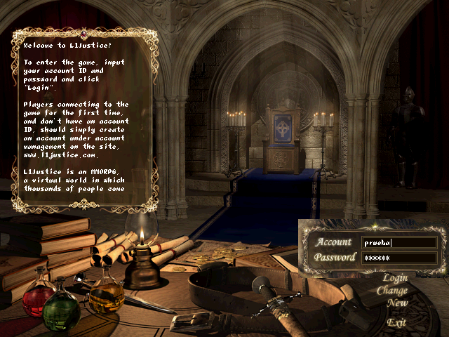

**Funciona:**
- Fondo `814.png`: viene ofuscado (`\x89PNX` + XOR encadenado) en `Sprite00.pak`, que se elige por el hash del nombre.
- Recuadro `59.img` y botones Login/Change/New/Exit (`53/65/55/57.img`, con imagen de resaltado N+1).
- Texto de bienvenida de `intro-e.tbl`, de `Text.pak` descifrado con DES.
- Fuente original `eng.fnt`.
- Cajas de usuario y clave con cursor y asteriscos, Tab y Enter.
- Conexión: paquete inicial sin cifrar, derivación de clave y cifrado en ambos sentidos.
- Versión y login. Errores del servidor (usuario/clave, cuenta en uso) y ventana de noticias.

**Verificado:**
- Login real contra el servidor, con la traza `LIN_TRAZA=1`.
- Tests de cifrado con vectores de la implementación Python que coincide con el cliente original.
- Test de DES con el vector estándar.
- `.pak` y `814.png` probados contra los archivos reales.

**Pendiente:**
- "Change" y "New" no hacen nada: L1J crea las cuentas solas.
- Música del login (`lin_audio`, entregable 10).
- Opciones (entregable 10).

**UI simple del login** (con `ui_simple=1`, la de siempre; F2 vuelve a la original):
- Fondo oscuro, logo arriba y un recuadro con Account, Password, Login y Quit; abajo, el servidor.
- **Logo propio:** `logo=` en `settings.ini` (o `--logo=`): un PNG con alfa de hasta 2048×2048, ruta absoluta o relativa a la carpeta de `settings.ini`, achicado para entrar en 560×190. Sin logo, o si no se puede leer, "LINEAGE" en texto (y un aviso en el registro).
- Capturas: `docs/capturas/1_login_simple.png` y `1_login_logo.png`.

## Entregable 2: Selección y creación de personaje ✅

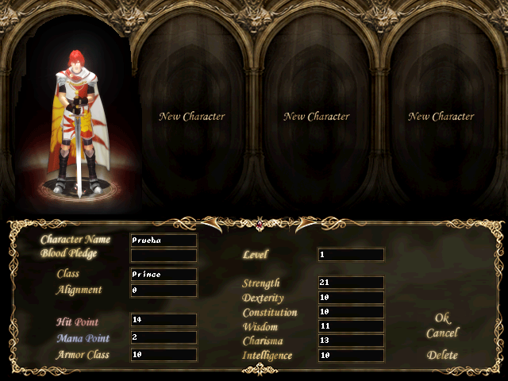 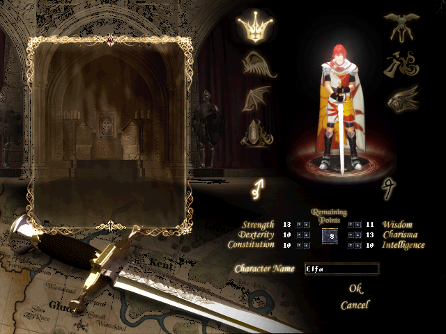

**Funciona:**
- **Selección:**
  - fondo `815.png` y 4 ranuras con las animaciones PNG por clase y sexo (posiciones de `sdl_animate_button.cpp`);
  - la ranura seleccionada se anima; las vacías dicen "New Character" y se animan al pasar el mouse;
  - panel con nombre, clan, clase, alineamiento, HP, MP, CA, nivel y los 6 stats;
  - botones entrar, volver y borrar, y páginas.
- **Creación:**
  - fondo `824.img`, 7 clases y 2 sexos (radios con imagen), vista previa animada;
  - stats con botones +/− y puntos restantes;
  - las reglas de `C_CreateChar.java`: mínimo y máximo por clase, total 75;
  - nombre y mensajes de error del servidor.

**Verificado:**
- Se creó "Exploradora" en el servidor real (NEWCHARWRONG 2 + NEWCHARPACK) y aparece en la lista seleccionada.
- La lista coincide con lo que manda el servidor.
- Test de decodificación de `S_CharPacks`.

**Resplandor de las animaciones** (antes: un disco oscuro detrás del personaje seleccionado):
- Las animaciones PNG traen, sobre negro, un resplandor en degradé de 0x01 a ~0x40 que el original sumaba al fondo. Solo se quitaba el negro y los casi negros, y el resto del degradé quedaba opaco.
- **Ahora** (`quitar_fondo_negro`): desde el negro puro se recorren los píxeles oscuros unidos a él y cada uno pasa a alfa proporcional a su brillo, con el color compensado; al dibujarse equivale a sumarlo al fondo. Lo oscuro dentro de una figura (las versiones apagadas) queda opaco. Verificado en captura y con un test.

**UI simple** (con `ui_simple=1`; F2 vuelve a la original):
- **Selección:** lista de todos los personajes (nombre, nivel, clase, clan) y "+ New character" en las ranuras libres; a la derecha, la animación y los datos del elegido; Enter, Delete (pide un segundo clic: "Sure?") y Back.
- **Creación:** clase y sexo a la izquierda; atributos con −/+, puntos libres, nombre y la animación a la derecha; Create y Back.
- Capturas: `docs/capturas/2_seleccion_simple.png` y `2_crear_simple.png`.

**Pendiente:**
- Las flechas de página (`1765/1767.img`) no se ven con esta instalación: falta buscar sus nombres nuevos.
- Borrar no pide confirmación en la pantalla original (sí en la simple).
- Crear y borrar desde la UI simple solo se probó con la automatización, no a mano.

## Entregable 3: Dentro del juego, moverse ✅

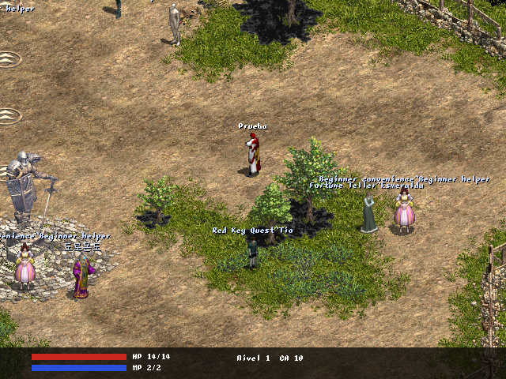 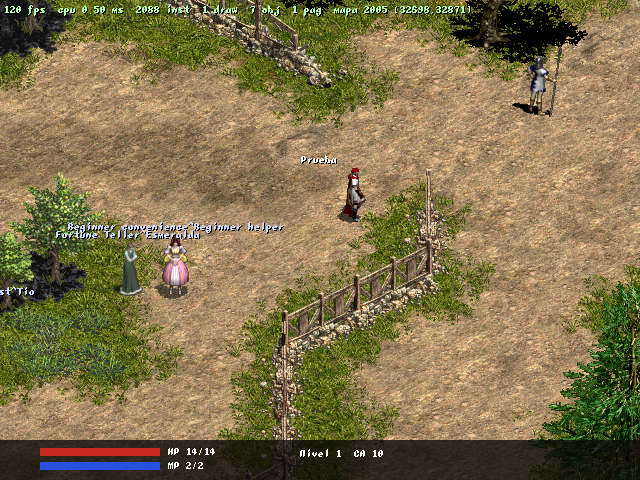

**Funciona:**
- **Mapa:**
  - suelo isométrico de los `.s32` (segmentos de 64×64 cargados bajo demanda);
  - medios tiles de `Tile.pak`;
  - objetos del mapa (árboles, cercas, piedras) ordenados por profundidad.
- **Personajes y NPCs** (S_CharPack):
  - sprites compuestos desde los `.spr`;
  - acción caminar o quieto según el arma, en 8 direcciones, con la tabla de acciones y sombra;
  - nombres `$N` resueltos desde `desc-e.tbl` (p. ej. "Red Key Quest'Tio");
  - nombres coreanos con `kor.fnt` ("도도로도").
- **Objetos del mundo:** aparecen, se mueven con interpolación y desaparecen (S_MoveCharPacket, S_RemoveObject, S_ChangeHeading).
- **Movimiento propio:**
  - clic mantenido o flechas;
  - predicción local y C_MoveChar al servidor;
  - colisiones con el bit 0 del atributo del `.s32`;
  - giro si la celda está bloqueada.
- **Salida:** C_QuitGame al salir, para que el servidor guarde la posición.
- **HUD mínimo:** HP, MP, nivel, CA y últimos mensajes de chat.

**Verificado:**
- **Movimiento contra el servidor:** con `--pasos=4` el cliente envió 4 C_MoveChar desde (32691, 32864) hacia la dirección 3, y la base quedó en (32695, 32868). El servidor reubica al personaje en (32691, 32864) en cada login porque el mapa 2005 tiene punto de reinicio (`RestartLocationTable`).
- **Ritmo de los pasos:** el paso propio dura 672 ms (640 × 1,05, como el original). Con 640 ms justos, el anti-acelerador de L1J (`AcceleratorChecker`, `CheckStrictness=102`) contaba cada paso como demasiado rápido: a los 10 pasos seguidos mostraba "Overspeed detected" y desconectaba. Verificado: 40 pasos seguidos de un personaje no GM, con un intervalo mínimo de 674 ms y sin avisos.
- **Cámara suave y pasos continuos:**
  - **Antes:** todo se dibujaba a 640×480 con la cámara redondeada a píxeles enteros. El mundo avanzaba de a saltos de 1 px a un ritmo irregular, el personaje oscilaba ±1 px respecto del suelo y cada paso empezaba un frame tarde, con una pausa.
  - **Ahora:**
    - se dibuja en una textura de 640×480 × la escala entera de la ventana, con posiciones fraccionarias llevadas al píxel real más cercano: el arte sigue nítido y la cámara avanza de a 1/escala de píxel;
    - la proyección y la interpolación usan `double`, porque las coordenadas (~32 000) en `float` perdían ~0,2 px;
    - los pasos se encadenan, de modo que cada uno empieza donde terminó el anterior;
    - la animación de caminar se estira a la duración del paso.
  - **Medido** con 12 pasos seguidos a escala ×3: la cámara se mueve en 996 de 1050 frames, en saltos de 1/3 px, sin cortes entre pasos, con intervalos de envío de 666–676 ms y sin avisos del servidor.
- **Movimiento de monstruos y NPC:**
  - **Error en el parser de `sprite_table.txt` (afectaba a todas las animaciones):**
    - un sufijo suelto (`4>`, `6!`) se comía el primer número del frame siguiente y desfasaba la acción (el caminar del goblin daba 15 s);
    - `110 N` se tomaba como velocidad de todo el sprite con la fórmula 1000/N, pero es la velocidad de las acciones que siguen, y cada tick dura 960/N ms (como `spr_actions` del servidor);
    - los frames de duración 0 se contaban como 1 tick.
  - **Resultado:** de 9837 acciones de `spr_actions` del servidor, 5882 dan la misma duración en el cliente, 44 difieren solo por 1 ms de redondeo, 28 difieren de verdad (sprites distintos entre versiones) y 3883 no están en la tabla de l1j-client.
  - **Duración del paso:** cada objeto usa la animación de caminar de su sprite y su arma, ×3/4 con haste y ×4/3 con lentitud. Antes eran 640 ms fijos, así que un monstruo cruzaba la celda y se quedaba quieto hasta el paso siguiente. Si el sprite no está en la tabla, se usan 640 ms.
  - **Sin saltos:** un movimiento que llega antes de terminar el paso sigue desde la posición interpolada (columnas `O_XANT/O_YANT` en `double`).
  - **Sin parpadeo entre pasos:** la animación de caminar sigue un cuarto de paso más, porque el siguiente paquete suele llegar unos ms tarde.
  - **Medido** con 10 monstruos invocados por GM (`.spawn`): los pasos duran lo mismo que en el servidor (goblin 760 ms, orco 800, conejo 960, kobold 1280, rana 1440). El desplazamiento máximo entre frames fue de 0,57 px, sin saltos de más de 4 px, con 1 pausa corta en ~25 000 frames con movimiento.
- **Los frames de caminar ya traen el avance:**
  - **Qué hacen los `.spr`:** el cuerpo avanza 0, ¼, ½ y ¾ de celda respecto de la celda de origen.
    - En el personaje (archivos `3225-*.spr`, el alias del gfx 0), los pies avanzan 0, 12, 24 y 36 px en horizontal.
    - Lo mismo pasa en los monstruos (rana, goblin, orco, conejo), con su cantidad de frames.
  - **El error:** el cliente además interpolaba la posición, así que el cuerpo recorría casi 2 celdas por paso y volvía a la real al terminar. Era el "paso largo que vuelve atrás".
  - **Ahora:**
    - los sprites se dibujan en la celda de origen durante el paso (`origen_paso`) y la animación hace el resto, como el original, con los pies fijos sobre el suelo;
    - la posición continua queda para la cámara, el orden de dibujo, los nombres y los globos.
  - **Cámara:**
    - suave por defecto: tu personaje se compensa con `fraccion_frame` para quedar centrado;
    - con F4, "a saltos": sigue los frames, de a ¼ de celda.
  - **Verificado:** 4 pasos contra el servidor sin avisos, y una captura a mitad de paso con el personaje centrado.
- **Vista ampliable:**
  - **Tamaño lógico:** dentro del juego es ventana ÷ escala (mínimo 640×480), y la escala se ajusta con Ctrl/⌘ +/−/0 (`zoom` en `settings.ini`).
  - **Disposición:**
    - el panel original queda centrado abajo y la ventana de estado se apoya en el borde derecho;
    - el suelo, los objetos del mapa (con más segmentos cargados alrededor) y el recorte de los personajes se calculan según el tamaño de la vista.
  - **Fuera del juego:** el login y los personajes siguen en 640×480 centrados.
  - **Medido** (Release, ventana 1600×900 en Retina):
    - con zoom automático (×3): 1008×551 lógicos, 3830 instancias y 0,78 ms de CPU;
    - con zoom ×2: 1512×827 lógicos, 6681 instancias y 1,57 ms de CPU por frame;
    - 1 llamada de dibujo y 120 fps en ambos casos.
  - **Límite del servidor:** con `PcRecognizeRange=-1` (configuración actual), L1J manda los personajes y NPC dentro de la pantalla del original. Con una vista muy grande, el mapa se ve completo, pero los personajes lejanos aparecen recién al acercarse. En el servidor local se puede subir ese valor en `config/server.properties.xml`.
- **Orientación del `.s32` y bit de bloqueo:** comparados contra el mapa del servidor (`maps/2005.txt`) en los 35 segmentos del mapa 2005.
  - Leyendo "y exterior, x interior", las combinaciones quedan limpias: tile transitable 31 ↔ atributos 4/4 en 63 341 celdas, y tiles bloqueados 0/16 ↔ atributos con el bit 0 activo.
  - La orientación opuesta mezcla transitables con bloqueados.
  - El test `Mapa 2005` exige al menos 95 % de coincidencia en el segmento inicial.
- **Ancla de los sprites:** calibrada con el explorador; los pies quedan en el centro del rombo (`docs/capturas/explorador_gfx0.png`).
- **Rendimiento (Release, overlay F3):**
  - **0,50 ms de CPU por frame** con 2088 instancias, frente a los 2 ms presupuestados;
  - **1 llamada de dibujo por frame**;
  - 1 página de atlas;
  - 120 fps (vsync).

**Pendiente o conocido:**
- **Orden entre objetos del mapa y personajes** (antes: cada pieza por su propia fila, así que un personaje detrás de un árbol quedaba sobre la copa):
  - **Ahora:** cada pieza de un objeto se ordena por el pie del objeto en su columna de pantalla y en las vecinas (±3 celdas, `COLUMNAS_BASE`). La copa usa la fila del tronco y una pared larga, la de su tramo. Dentro de la misma fila de pie van primero las piezas más altas y al final los personajes.
  - **Verificado** con `--ruta` en el árbol del punto de inicio: detrás, la copa tapa al personaje; delante, el personaje queda sobre el tronco. Hay un test con el `.s32` real.
  - **Pendiente:** compararlo con el original en zonas con casas y muros grandes.
- **Piezas pegadas al suelo** (antes: las sombras de los árboles y algunos parches de arena se dibujaban sobre los personajes):
  - **Ahora:** las piezas de capa 15 o menor (`CAPA_MAX_SUELO`: sombras, arena, flores) se dibujan con el suelo, debajo de todo lo que se levanta, y no cuentan para el pie de los objetos. En el mapa 2005 hay ~36 000 en las capas 1–9 y casi ninguna en 10–15; los objetos que se levantan empiezan en la capa 16.
- **Sombras translúcidas** (antes: manchas negras opacas):
  - **El dato:** el byte de tipo de cada tile tiene un bit 0x04 (tipos 0x06/0x07) que llevan todas las sombras de árboles (las 15 996 piezas de capa 8 en el mapa 2005) y casi ninguna pieza que se levanta (1 de 35 395). Todos sus píxeles son grises oscuros o negros.
  - **Ahora:** esos tiles se decodifican con alfa 50 % (`ALFA_TRANSLUCIDO`) y se mezclan con el suelo.
  - **Personajes en la sombra:** dibujar la sombra encima del personaje lo oscurecería también donde el cuerpo sube por encima de ella. En su lugar, el personaje cuya celda tiene una sombra se dibuja oscurecido (×150/255). F5 lo apaga (`sombra_personajes` en `settings.ini`). No hay forma de compararlo con el original desde los datos.
  - **Verificado:** capturas con F5 encendido y apagado junto al árbol del punto de inicio: el personaje en la sombra se oscurece y fuera de ella queda igual. Hay un test con el `.s32` real.
- Luz y noche (S_Light y S_GameTime se reciben y guardan, pero todavía no se dibujan), y clima.
- Las acciones puntuales (ataque, daño) se guardan y animan, pero el combate es el entregable 5.
- Rendimiento: ver la sección [Rendimiento](#rendimiento) (precarga en un hilo, reemplazo LRU del atlas y test de cero allocations).

## Entregable 4: Chat y estado ✅

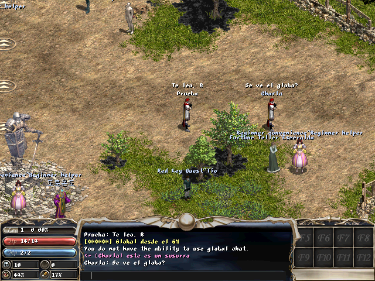 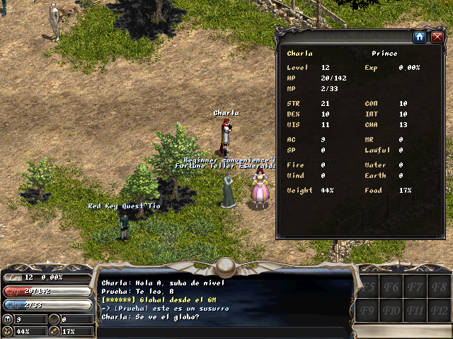

**Funciona:**
- **Panel inferior original:** `1028.img` (barras), `1042.img` (chat), `1019.img` (teclas F5–F12) y `1039.img` (entrada), en las posiciones de l1j-client.
  - Barras de EXP (`1029`), HP (`1030`) y MP (`1031`): se recortan según el valor y el rótulo queda siempre visible.
  - Casillas de CA, alineamiento, peso y comida.
- **Chat:**
  - el registro es un anillo de 256 líneas de tamaño fijo, así que agregar un mensaje no reserva memoria;
  - las líneas se ajustan al ancho del panel sin partir caracteres coreanos;
  - se desplaza con la rueda del mouse sobre el panel o con Re Pág / Av Pág;
  - la caja de entrada tiene siempre el foco, como en el original: se escribe, Enter envía y Esc borra;
  - los prefijos del original eligen el canal: `!` grito, `&` global, `$` comercio, `@` clan, `#` grupo, `%` alianza, `*` grupo de chat y `"nombre texto` para susurrar;
  - cada canal tiene su color;
  - el chat normal y el grito aparecen 5 s sobre la cabeza de quien habla.
- **Mensajes del servidor:**
  - `S_ServerMessage` y `S_BlueMessage` se arman con `string-e.tbl` (id = línea): `%0`/`%1` se reemplazan por los argumentos y los `$N` por `desc-e.tbl`;
  - los códigos de color `\fX` se quitan y el primero colorea la línea;
  - se muestran los mensajes del sistema (`S_SystemMessage`), los anuncios del servidor y lo que dicen los NPC (`S_NpcChatPacket`, con `$N` resuelto).
- **Estado en vivo:**
  - `S_OwnCharStatus`, `S_HPUpdate`, `S_MPUpdate`, `S_Exp`, `S_Lawful`, `S_SpMr`, `S_OwnCharAttrDef`, `S_OwnCharStatus2` y `S_PacketBox` (peso y comida) actualizan el estado del jugador (`EstadoJugador`, el módulo "Player" del plan);
  - el porcentaje de EXP usa la tabla de `ExpTable.java`.
- **Ventana de estado (Alt+C):** muestra nombre, clase, nivel, EXP, HP, MP, los 6 atributos, CA, MR, SP, alineamiento, las 4 resistencias elementales, peso y comida. Se cierra con la X del marco.

**Verificado:**
- **Dos clientes conversan** (`4_chat.png` es lo que ve A y `4_estado.png` lo que ve B), con dos cuentas a la vez contra el servidor local:
  - B dice "Hola A, subo de nivel" y A responde "Te leo, B": cada uno lo ve en su registro y sobre la cabeza del otro.
  - Grito: llega como `<Charla> ...` en naranja.
  - Global de B (GM): A lo recibe como `[******] ...` en amarillo.
  - Global de A (nivel 1): el servidor responde con el mensaje 195, que se muestra como "You do not have the ability to use global chat.".
  - Susurro: B ve el eco `-> (Prueba) ...` y A recibe `<- (Charla) ...` en rosa. Antes del nivel 5, el servidor responde con el mensaje 404 ("A character below level %0 cannot whisper...").
- **El estado se actualiza en vivo:** B escribe `.level 12` (comando de GM del servidor). Sin salir del juego, la barra y la ventana de estado pasan a nivel 12, HP 20/142, MP 2/33 y CA 9, y la regeneración llega después en `S_HPUpdate`.
- El mensaje 3247 que manda el servidor al entrar coincide con su línea de `string-e.tbl` ("Inform the creation of the clan!" ↔ 血盟を創設して…お知らせ).
- Los dos clientes completos corrieron con ASan + UBSan durante la conversación, sin reportes.
- **Rendimiento (Release, overlay F3):** con el panel, el chat y la ventana de estado abiertos, 0,52 ms de CPU por frame, 1 llamada de dibujo y 120 fps.

**UI simple (por defecto; F2 alterna con el panel original):**
- **Qué muestra:** una franja oscura de ancho completo abajo, solo con texto: 5 líneas de chat, la entrada `> ` y una línea de estado con barras ASCII (`Lv 1 [--------] 0.00%  HP [########] 14/14  MP [...]  AC  Lawful  Weight  Food`). La ventana de estado (Alt+C) es un recuadro de texto con `[x]`.
- **Lo que se comparte:** el chat (registro, desplazamiento, entrada, prefijos) y el contenido de la ventana de estado son los mismos en los dos modos; solo cambia dónde y cómo se dibujan (`AreaChat`, `Vista::panel_y`). La franja ocupa menos que el panel original, así que el área de juego crece.
- **Verificado** contra el servidor en 853×551 y en 640×480: la línea de estado entra con valores altos (nivel 12, HP 34/142), y el panel original sigue igual con `--ui_simple=0`. Captura: `docs/capturas/4_ui_simple.png`.

**Para repetir la prueba:**
- En el servidor local, `Charla` (cuenta `prueba2`) quedó como GM: `characters.access_level = 200`. Así se puede usar `.level`.
- Comandos:
  ```sh
  build/release/lineage --juego="$LINEAGE_DIR" --usuario=prueba2 --clave=prueba2 --auto --personaje=Charla --crear \
      --estado --decir="Hola A" --decir=".level 12" --decir="&Global" --decir='"Prueba psst' \
      --captura=b.bmp --captura-espera=1500 --salir &
  build/release/lineage --juego="$LINEAGE_DIR" --usuario=prueba --clave=prueba --auto --personaje=Prueba \
      --decir="Te leo, B" --captura=a.bmp --captura-espera=600 --salir
  ```

**Pendiente o conocido:**
- **Ventana de estado:** no encontré la imagen exacta del original en esta instalación. Se usa el marco genérico `4131.img` con el contenido escrito encima.
- **Colores:** los de cada canal y los de los códigos `\fX` son aproximados. La paleta real está en `lin.bin`.
- **Entrada de texto:** acepta solo ASCII. Para escribir en coreano falta la conversión de UTF-8 a CP949 de la entrada IME.
- **Lo que todavía no hace el panel:**
  - las flechas de desplazamiento y el botón para agrandar el chat (`1045`–`1056`) son gráficos sin función;
  - las teclas F5–F12 no hacen nada (eso llega con los atajos, en el entregable 6);
  - no hay filtros por canal, que en el original se configuran en las opciones.
- **Chat de clan y de grupo:** se envían y se decodifican (tipos 4, 11, 13 y 14), pero no se pudieron probar porque todavía no se pueden crear clanes ni grupos.

## Entregable 5: Combate ✅

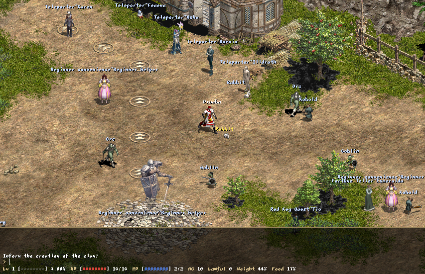 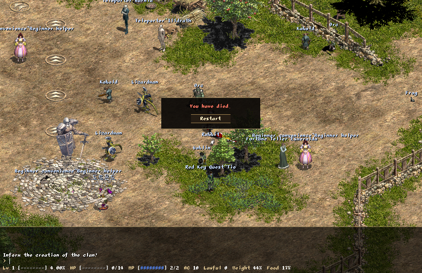

**Funciona:**
- **Atacar:**
  - mantener el clic sobre un personaje lo convierte en objetivo (nombre en amarillo);
  - lejos, se camina hacia él; al lado, se manda `C_Attack` (op 68: id, x, y del objetivo) y la animación de ataque propia empieza enseguida;
  - el eco del servidor no la reinicia;
  - el ritmo es la duración de la animación de ataque del sprite × 1,05, porque el anti-acelerador del servidor también controla los ataques (`CheckAttackInterval`).
- **Paquetes de ataque:** `S_AttackPacket`, `S_AttackMissPacket`, `S_AttackPacketForNpc` y `S_UseAttackSkill`/`S_UseArrowSkill` (op 142: acción, atacante, objetivo, golpe y dirección) animan al atacante.
- **Daño:**
  - si el golpe acierta, el objetivo muestra la animación de daño en el frame de impacto del ataque (sufijo `!` de la tabla de sprites, que ahora se guarda);
  - el servidor no le manda a quien ataca el `S_DoActionGFX` de daño de su objetivo, así que el cliente lo deduce del golpe.
- **Muerte:**
  - `S_DoActionGFX` 8 o el estado 8 en `S_CharPack` dejan al objeto como cadáver, con la animación de morir detenida en el último frame, hasta que el servidor lo quita;
  - un cadáver no reacciona a más acciones.
- **Muerte propia:** aparece el aviso "You have died." con **Restart**, que manda `C_Restart` (op 71), descarta los objetos conocidos y espera a que el servidor reenvíe la escena.
- **Barra de vida:** se dibuja sobre los objetos cuyo HP se conoce (`S_HpMeter`, op 128).

**Verificado contra el servidor:**
- **Matar un monstruo** (conejo, gfx 998):
  - 10 `C_Attack` separados por al menos 841 ms (800 ms de animación × 1,05), sin avisos del anti-acelerador;
  - `S_DoActionGFX` con acción 8 y `S_Exp`: el personaje pasó de 0 a 5 de experiencia y luego a 10 (se repitió con el servidor recién reiniciado).
- **Morir y reiniciar:**
  - dos hombres lagarto agresivos (`.spawn 45144`) mataron a Prueba; el aviso aparece con HP 0/14 (`5_muerte.png`);
  - con `--reiniciar`, 5 s después sale `C_Restart` y el servidor responde con `S_HPUpdate`, `S_MapID`, el propio `S_CharPack` y los objetos visibles (el ciclo se repitió 3 veces).
- **Ver a otros pelear:** los ataques de los monstruos contra otro personaje se procesan, y su HP baja en vivo.
- **Sanitizers:** los tests pasan con ASan + UBSan.

**Pendiente o conocido:**
- **Barra de vida de los monstruos:** L1J-JP 3.63c no la manda (`S_NPCPack` lleva 0xFF y `S_HpMeter` solo va al grupo y las mascotas).
- **Daño:** el servidor solo indica si acertó, no el número, así que no hay cifras de daño.
- **Distancia:** resuelto más tarde; ver "Ataques con arco" abajo.
- **Sonidos de combate:** van con el audio, en el entregable 10.
- **Aviso de muerte:** no es el diálogo original.
- **NPC no monstruos:** hacer clic sobre ellos también los "ataca" (el servidor no les hace daño); hablar con NPCs llega con `C_NPCTalk` en un entregable posterior.
- **En el servidor local:**
  - Charla quedó en nivel 70 por la prueba;
  - reinicié el servidor para quitar los hombres lagarto que invoqué.

## Entregable 6: Inventario e ítems ✅

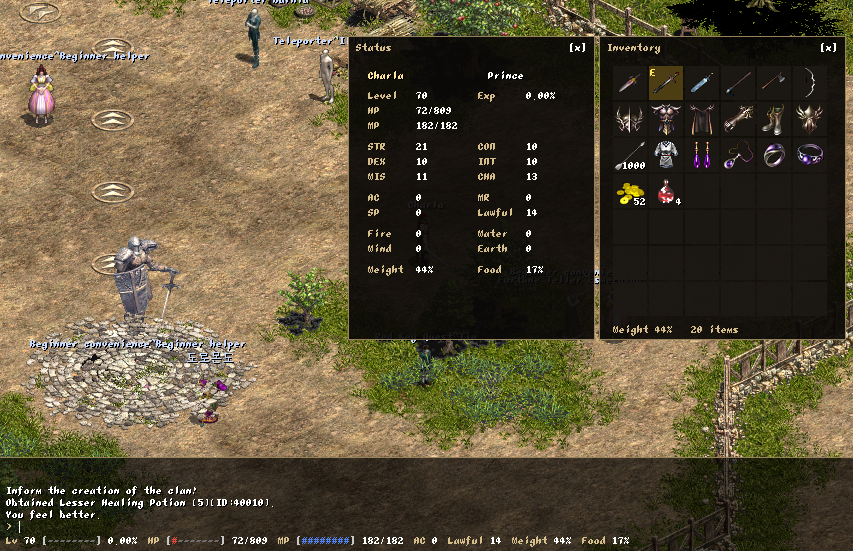 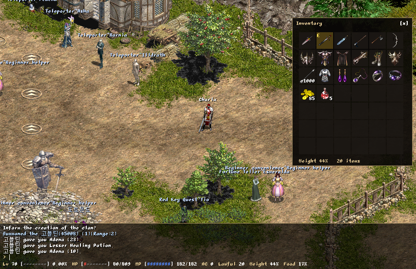

**Funciona:**
- **Inventario (`Inventario` en `mundo/inventario.h`, tabla columnar por id):**
  - lo llena `S_InvList` (op 180, varios eventos por paquete) y lo actualizan `S_AddItem` (63), `S_DeleteInventoryItem` (148), `S_ItemName` (195), `S_ItemAmount`/`S_ItemStatus` (127) y `S_ItemColor` (144);
  - un ítem está equipado si el servidor agrega " ($9)" (arma) o " ($117)" (armadura) a su nombre.
- **Ventana (Alt+I, `app/inventario_ui.cpp`):**
  - grilla de 6×7 con los íconos originales y desplazamiento con la rueda;
  - cantidad, marca "E" en los equipados y nombre con los `$N` resueltos al pasar el mouse (amarillo si es bendito, rojo si es maldito);
  - peso abajo;
  - doble clic manda `C_UseItem` (op 44: id + 0): equipar o quitar, beber;
  - arrastrar un ítem fuera de la ventana manda `C_DropItem` (op 54) en la celda propia.
  - Con la UI simple usa el mismo recuadro de texto que la ventana de estado (`ui::ventana`).
- **Íconos:** son los `N.tbt` de los SpriteNN.pak (2180 archivos). Tienen el mismo formato que un tile con transparencia, sin el byte de tipo (`decodificar_tbt`).
- **Ítems del suelo:**
  - llegan como `S_DropItem` con el mismo opcode y formato que `S_CharPack` (el campo de experiencia es la cantidad);
  - se reconocen por el tipo de gfx (atributo 102 de la tabla de sprites: 9 ítem, 10 monstruo, 5 personaje; los NPC son 6 y 12);
  - no tienen acciones, así que se dibuja el frame 0 de `N-0.spr`;
  - clic: si está lejos se camina hasta él y se manda `C_PickUpItem` (op 188);
  - el nombre se ve solo con el puntero encima.
- **Clic sobre el mundo según el tipo:** un ítem se recoge, un monstruo se ataca, y a otros personajes y NPCs solo con Ctrl. Antes cualquier clic atacaba, también a los mercaderes.

**Verificado contra el servidor:**
- **Equipar:** doble clic (o `--usar`) sobre la espada de una mano. Llegan `S_ItemName` "$3279 ($9)" y `S_CharVisualUpdate` con arma 4, y el sprite pasa a la variante con espada (se ve en las capturas).
- **Poción:** `.item 40010 5` y después usarla. HP de 20 a 69, `S_ItemAmount` "$26 (4)" y los mensajes "Obtained Lesser Healing Potion (5)" y "You feel better.".
- **Botín:** Charla mató dos goblins.
  - Con `AutoLoot=1` (la configuración del servidor local) el botín entra al inventario: adena 52 → 75 → 85 y una poción más.
  - En el chat aparece "고블린 gave you Adena (23)" (el servidor manda el nombre del monstruo en coreano).
- **Soltar y recoger:** al soltar llegan `S_DeleteInventoryItem` y el ítem en el suelo. Con `--recoger` el personaje camina hasta él, manda `C_PickUpItem` y vuelve con `S_AddItem`. La adena soltada se ve en el suelo con su sprite.
- **Peso:** se actualiza en vivo (`S_PacketBox` 10).
- **Sanitizers:** los tests pasan con ASan + UBSan.

**Pendiente o conocido:**
- **Ventanas:** no identifiqué las originales de inventario y estado en esta instalación; las dos usan el marco 4131 (o el recuadro simple).
- **Usos especiales:** los ítems que piden un objetivo (pergaminos de teletransporte o identificación, varitas, hechizos) necesitan campos extra en `C_UseItem`; llegan con sus entregables.
- **Cantidades:** no hay diálogo de cantidad: soltar suelta todo el montón.
- **Ítems no transferibles:** las armas "Ivory Tower" de principiante no se pueden soltar; el servidor ignora el pedido sin avisar.
- **Durabilidad y encantamiento:** se reciben dentro del nombre pero no se muestran aparte.

## Entregable 6.5: Hechizos y habilidades ✅

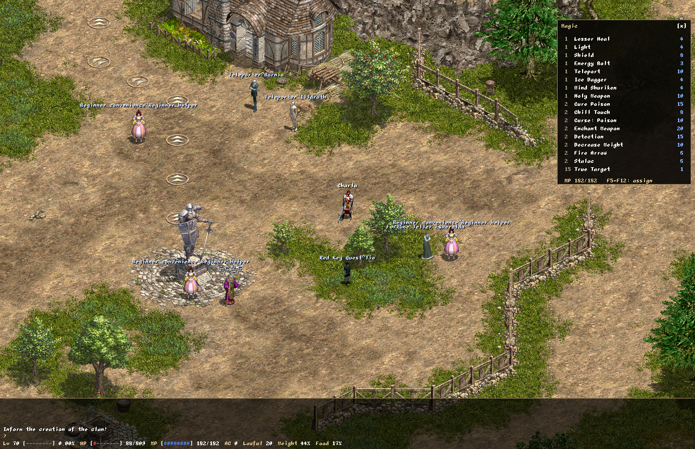 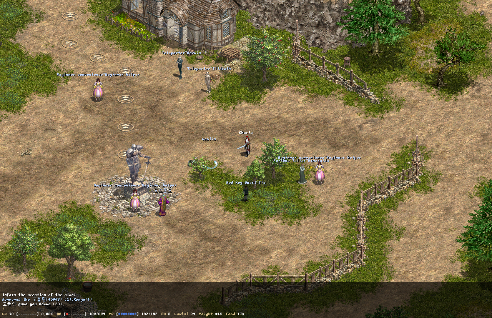 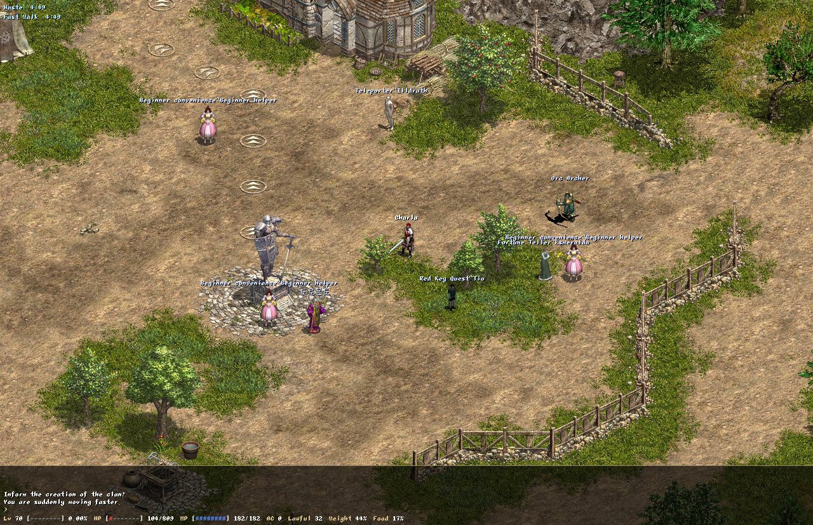 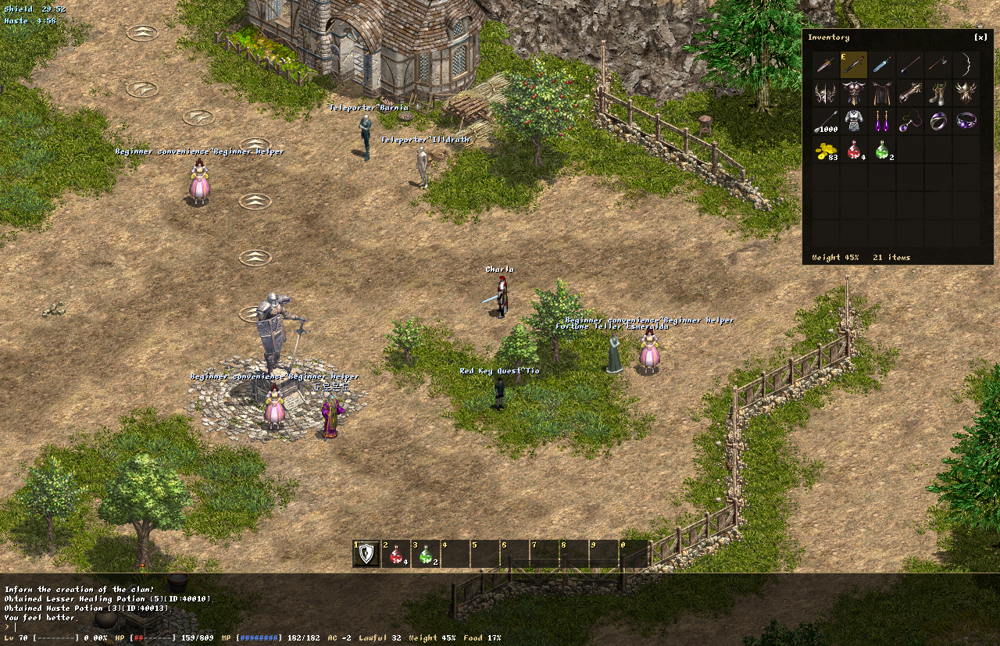

Adelanta la parte de uso del entregable 8 del plan: lanzar hechizos, sus efectos visuales, los efectos activos y la velocidad con haste y brave. Quedan para el 8 el arte original de la ventana y los íconos.

**Datos** (del cliente original, en `Text.pak`; `recursos/hechizos.*`):
- **Qué trae cada archivo:**
  - `spelldesc-e.tbl`: nombre y costo ("Lesser Heal (4/0)");
  - `spellexdesc-e.tbl`: la ficha que se muestra al pasar el mouse;
  - `spells`: alcance, gráfico, demora entre usos (`useDelay`) y clase.
- **Objetivo:** si el hechizo pide elegir un personaje o monstruo sale del "Targets:" de la ficha y del alcance. Coincide con la tabla `skills` del servidor en 175 de 183 hechizos; los 8 restantes son casos que el servidor resuelve solo.
- **Acción con la que se lanza:** sale de la clase. Las de ataque (`SpellAttack`, `SpellMassAttack`...) usan la 18 y las demás la 19, como `action_id` del servidor salvo en 1 hechizo. El servidor mide un intervalo distinto para cada una.

**Protocolo:**
- **Lo que se sabe:** `S_AddSkill` / `S_DelSkill` llegan como filas de bits (hechizo = fila × 8 + bit + 1).
- **Lanzar:** `C_UseSkill` (fila, columna y, si hay objetivo, id y celda).
- **Efectos visuales:**
  - el hechizo de ataque llega en el mismo paquete que el golpe (`S_UseAttackSkill`), con el gráfico del proyectil y las celdas de origen y destino; se distingue por el largo;
  - `S_SkillSound` pone el gráfico sobre un objeto, `S_EffectLocation` en una celda, y `S_RangeSkill` hace la acción del lanzador y pone el gráfico sobre cada objetivo.
- **Velocidad y efectos activos:**
  - `S_SkillHaste` / `S_SkillBrave` dan la velocidad;
  - `S_SkillIconShield` y las auras e íconos de `S_PacketBox` (subtipos 0x16, 34 y 40) dan los efectos activos.

**Interfaz:**
- **Ventana de hechizos (Alt+S):**
  - los hechizos sabidos por nivel, con su MP (gris si no alcanza) y la tecla asignada;
  - con el mouse encima se ve la ficha; clic lanza;
  - con el puntero sobre un hechizo, F5–F12 lo asigna a esa tecla.
- **F5–F12:** lanzan el hechizo asignado. Se guardan por personaje en `settings.ini` (`atajos=`).
- **Hechizo con objetivo:**
  - espera el clic sobre un personaje o monstruo (también uno mismo); clic derecho o Escape cancelan;
  - si está más lejos que el alcance, se camina hasta él y se lanza;
  - un clic nuevo en el suelo cancela el hechizo en camino.
- **Animación propia:** empieza al pedirlo (el eco del servidor no la reinicia). No se hace otra acción hasta que pasa el intervalo que mide el servidor, ni se lanza otro hechizo antes de su `useDelay`.
- **Barra de atajos (Alt+1..Alt+0, `app/barra_ui.cpp`):**
  - diez casilleros abajo al centro, sobre el panel;
  - se llena arrastrando un hechizo desde su ventana o un ítem desde el inventario (soltarlo sobre la barra no lo tira al suelo);
  - entre casilleros se arrastra para moverlos; clic derecho o soltar fuera los vacía;
  - clic o Alt+número usa: el hechizo (si pide objetivo, espera el clic) o el ítem (como el doble clic del inventario);
  - muestra los íconos originales (`spellicon.idx` de `Sprite.pak` da el `N.tbt` de cada hechizo), la cantidad de los ítems y oscurece lo que no se puede usar (sin MP, hechizo no sabido, ítem que ya no está);
  - un ítem se guarda por su id y su gfx: si la pila se acabó y se consiguió otra, se usa esa;
  - se guarda por personaje en `settings.ini` (`barra=`);
  - clic del medio sobre un casillero lo elige (marco dorado; se guarda con un `*` en `barra=`) y el botón del medio sobre el mundo usa el elegido sobre lo que hay bajo el puntero, como en el original. Un hechizo con objetivo sin nada bajo el puntero no se lanza. El usuario lo probó en vivo;
  - **mantenido, repite:** un hechizo, en cuanto termina la espera (y no hay otro en camino), sobre lo que esté bajo el puntero en ese momento; un ítem, cada 500 ms. Verificado con `--medio=322,205,600` y Lesser Heal sobre Charla: 4 `C_UseSkill` en 5 s (uno al apretar y uno cada ~1,3 s), aceptados por el servidor ("You feel better"), y ninguno después de soltar;
  - **espera entre hechizos:** el servidor (L1J) tiene una sola espera para todos los hechizos (`reuse_delay`: 10 ms o 0 en casi todos, 1 s en unos pocos como Fireball) y no avisa al cliente: un hechizo durante la espera se ignora en silencio. Lo que más pesa es la animación del lanzado, que el servidor también controla. El cliente toma la mayor de las dos y la muestra en los casilleros de hechizos (barra y F5–F12): una sombra que se vacía de arriba abajo y los segundos con centésimas. Captura: `docs/capturas/8_espera_hechizos.png`;
  - en algunos teclados Alt con un número escribe un carácter (Option+2 = "@" en el teclado español del Mac): si sale un carácter ASCII se toma como texto, no como atajo.
- **F5–F12** siguen como atajos solo de hechizos.
- **Efectos activos:** arriba a la izquierda, con lo que les queda ("Shield 29:57", "Haste 4:49").
- **Teclas movidas:** el oscurecimiento en la sombra pasó a Shift+F4 y la captura de pantalla a Shift+F12.

**Gráficos:**
- **Cómo se dibuja cada efecto:**
  - la acción 0 del gráfico, una vez, sobre su objeto o en su celda;
  - el proyectil sale en el frame de impacto del lanzador y vuela 40 ms por celda (estimado; no está en los datos);
  - el objetivo muestra el daño cuando llega el proyectil.
- **Mezcla aditiva:** el atributo 104 de `sprite_table` con el bit 8 (1921 gráficos, todos efectos) marca que se dibujan sumando su luz al fondo. Sin eso, Energy Bolt se veía con un óvalo oscuro. El pipeline pasó a alfa premultiplicado: la mezcla normal y la aditiva van en la misma llamada de dibujo.
- **Efecto encadenado:** el atributo 109 dice qué gráfico sigue al terminar, por ejemplo la explosión de Energy Bolt (219) al llegar.

**Velocidad propia:**
- **Antes:** el paso propio era fijo (672 ms).
- **Ahora:** caminar, atacar y lanzar usan la duración del sprite con los factores del anti-acelerador del servidor (`AcceleratorChecker`): × 0,75 con haste, ÷ 0,75 lento, × 0,75 con poción de brave, × 0,87 con waffle, × 0,75 al caminar con Holy Walk, × 0,65 al atacar con Bloodlust.
- **Margen:** se mantiene el 5 %, y al caminar alcanza para encadenar pasos (con haste y Holy Walk el 5 % solo no alcanzaba).

**Verificado contra el servidor local** (Charla, GM, con `.addskill`):
- **Energy Bolt sobre un goblin invocado:**
  - el servidor respondió con la acción 18 y el gráfico 167;
  - en la captura se ve el proyectil y la explosión encadenada, sin fondo oscuro;
  - el goblin murió.
- **Shield:** llegaron el gráfico 221, la acción 19 y el ícono de 1800 s, y la CA bajó 2.
- **Lesser Heal sobre uno mismo:** "You feel better", +HP y los destellos del gráfico 744.
- **Haste y Holy Walk** (`.buff me 43 300` y `.buff me 52 300`): 27 pasos a 382–384 ms, sin avisos de exceso de velocidad. La lista de efectos muestra los dos.
- **Barra de atajos** (`--barra=` y `--alt=N`): con Shield en el 1 y las pociones de curación y de velocidad en el 2 y el 3, Alt+1 lanzó Shield, Alt+2 bebió la curación (5 → 4) y Alt+3 la de velocidad (3 → 2, llegó el haste). Las pociones se guardaron sin id y se encontraron por gfx.
- **Tests:** 7 casos en `tests/test_hechizos.cpp`:
  - paquetes con los bytes reales del servidor y `C_UseSkill`;
  - proyectil y momento del daño;
  - efectos activos y `S_RangeSkill`;
  - intervalos con haste y brave;
  - clasificación del objetivo;
  - datos reales del cliente;
  - valores por personaje de `settings.ini`.

**Pendiente o conocido:**
- **Interacción manual:** elegir el objetivo con el mouse, asignar teclas y arrastrar a la barra no se pudieron automatizar; la lógica está cubierta, pero falta probarlo a mano.
- **Hechizos con campos propios:**
  - Teleport necesita el marcador (`C_UseSkill` con mapa e id del marcador) y el ida y vuelta de `S_Teleport`;
  - también Fire Wall (celda) y Call Clan/Run Clan (nombre).
  - Hoy se mandan sin esos campos.
- **Íconos:** los efectos activos se listan como texto. Falta encontrar los íconos originales (`SpellIcon.idx` según l1j-client) y la ventana de magia original (imágenes 934–968).
- **Paquetes sin manejar:** `S_Paralysis`, `S_Poison`, `S_CurseBlind` y los sonidos.
- **Velocidad de los demás:** el brave de los demás no cambia su animación; sus pasos llegan antes y se encadenan.

## Entregable 6.6: Polymorph ✅

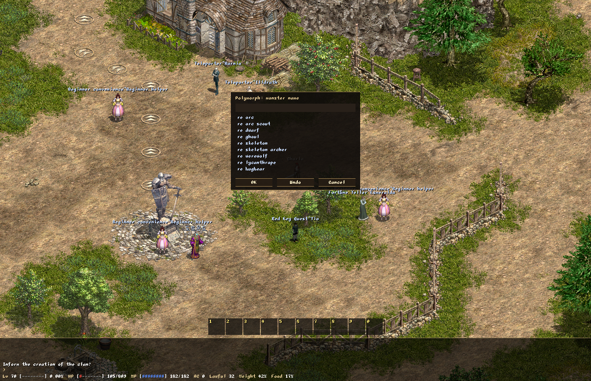 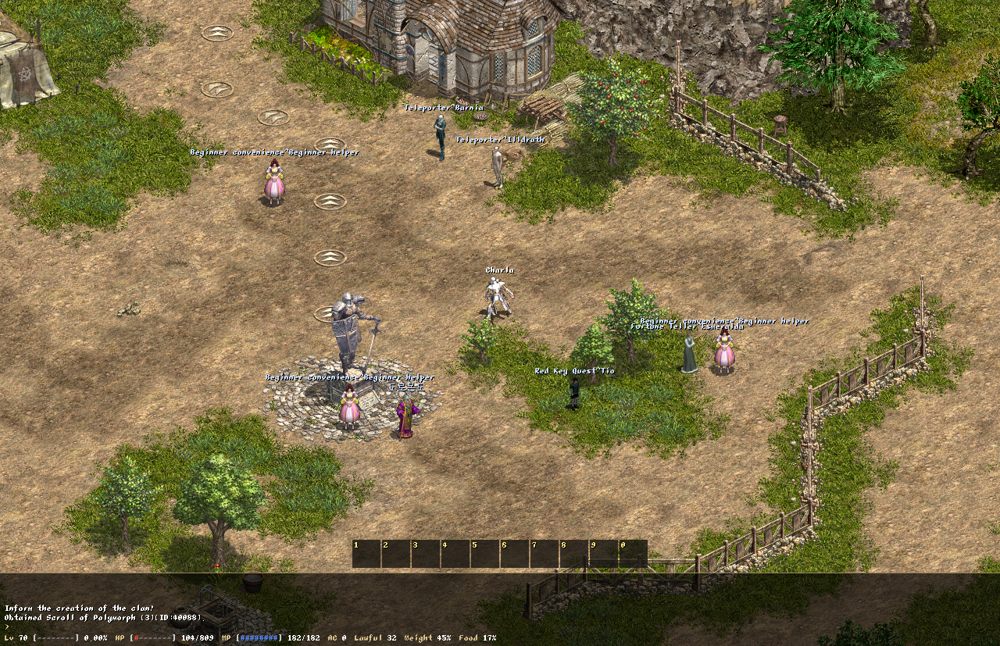 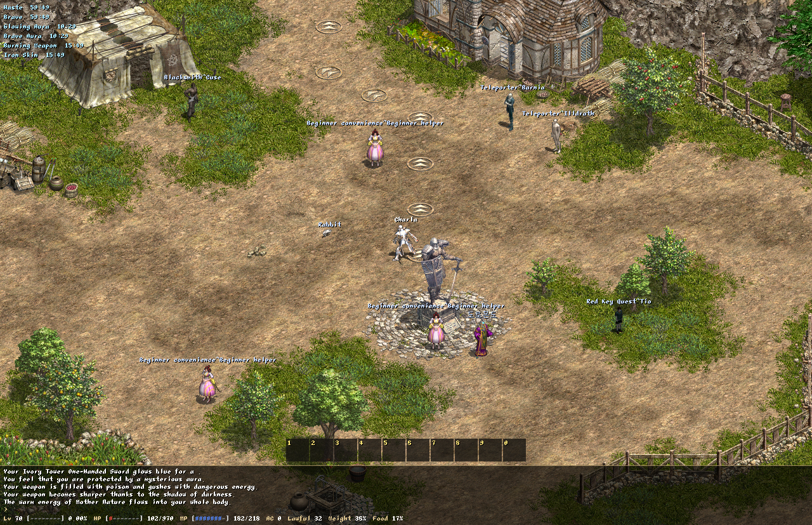

**Antes:**
- **`S_ChangeShape` se ignoraba:** quien se transformaba seguía con su sprite.
- **Riesgo de desconexión:** el servidor mide caminar, atacar y lanzar con el sprite de la forma actual (`getTempCharGfx`), y el cliente seguía usando el original. Con una forma más lenta, el cliente mandaba los pasos demasiado rápido y el servidor lo desconectaba ("Overspeed detected").
- **El pergamino no servía:** se mandaba como una poción, sin el nombre del monstruo.

**Ahora:**
- **`S_ChangeShape` (opcode 164):**
  - cambia el gfx del objeto y, si se sacó el arma, también su estado;
  - con eso cambian su animación, la duración de sus pasos y los intervalos propios (caminar, atacar, lanzar), que ya se calculaban con el sprite actual.
- **Diálogo de polymorph (`app/forma_ui.cpp`):**
  - **cuándo se abre:** al usar un pergamino (uso 16; con doble clic, desde la barra o con `--usar`);
  - **cómo funciona:** como en el original, se escribe el nombre del monstruo, en inglés como en `PolyTable` del servidor ("death knight");
  - **sugerencias:** las formas de `polymorph.tbl` que contienen lo escrito; clic en una la elige;
  - **botones:** Undo vuelve a la forma normal ("none") y Cancel o Escape cierran. Mientras está abierto, lo escrito no va al chat.
- **Respuestas al servidor:**
  - el pergamino responde con `C_UseItem` (id + nombre);
  - Shape Change (hechizo 67, "Polymorph" en los datos del cliente) llega como la página HTML "monlist" (`S_ShowHTML`, opcode 119) y se responde con `C_NPCAction` (id propio + nombre).

**Verificado contra el servidor local** (Charla, GM):
- **Pergamino** (`.item 40088 3`, `--usar=Polymorph --forma="death knight"`): llegó el polymorph al gfx 3784 y Charla se ve como death knight. Caminó 20 pasos a 666–683 ms, sin avisos de velocidad.
- **Duraciones:** las de 3784 en la tabla de sprites coinciden con `spr_actions` del servidor (caminar 640, atacar 600, hechizos 880/960 ms).
- **`.allbuff`** (polymorph 5641, haste y brave): pasos de 191–201 ms, sin avisos (el servidor exige 180 × 0,97). Antes el cliente caminaba a 672 ms con esa forma. La lista de efectos muestra los seis buffs.
- **Shape Change** (agregado a Charla en la base local): el servidor mandó "monlist", el diálogo respondió "death knight" y llegó el polymorph.
- **Tests:** `S_ChangeShape` con los bytes reales, el cambio de sprite y de paso, el arma, "monlist" y los dos comandos de respuesta.

**Pendiente o conocido:**
- **Restricciones de equipo:** el servidor saca o bloquea armas y armaduras según la forma (`weapon_equip` / `armor_equip`), y el cliente solo refleja el arma que se saca.
- **Lista de formas:**
  - `polymorph.tbl` tiene 97 formas (las "re ..." y "death 52"...); el servidor acepta 298, y las otras se escriben a mano;
  - no se filtra por nivel; el servidor responde con un mensaje si no se puede.
- **Duración:** no se muestra cuánto le queda al polymorph; el servidor no manda un ícono con la duración.
- **Ventana HTML:** "monlist" usa el mismo diálogo; la ventana HTML original llega con el entregable 7, que también traerá la página "RaiseAttr" que manda el servidor al entrar.

## Entregable 7: NPCs y comercio ✅

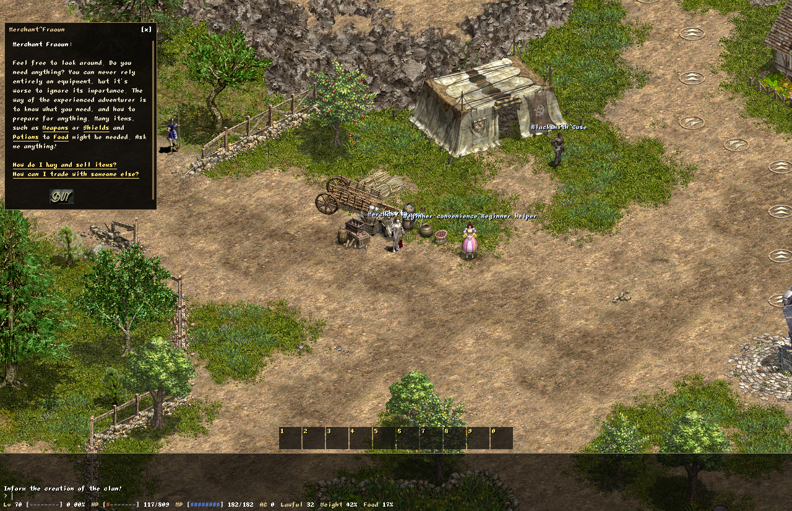 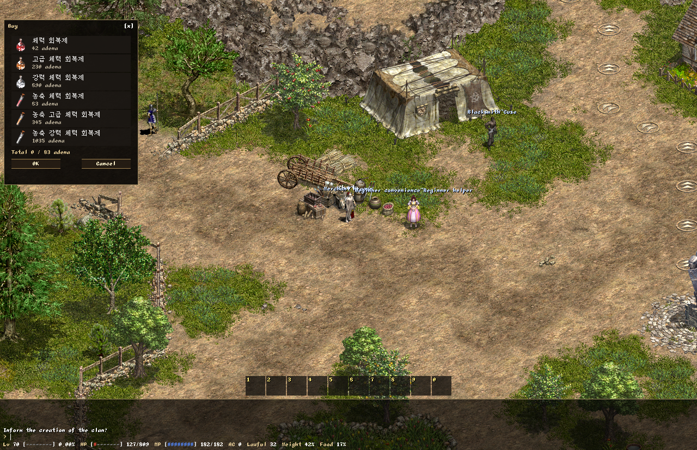 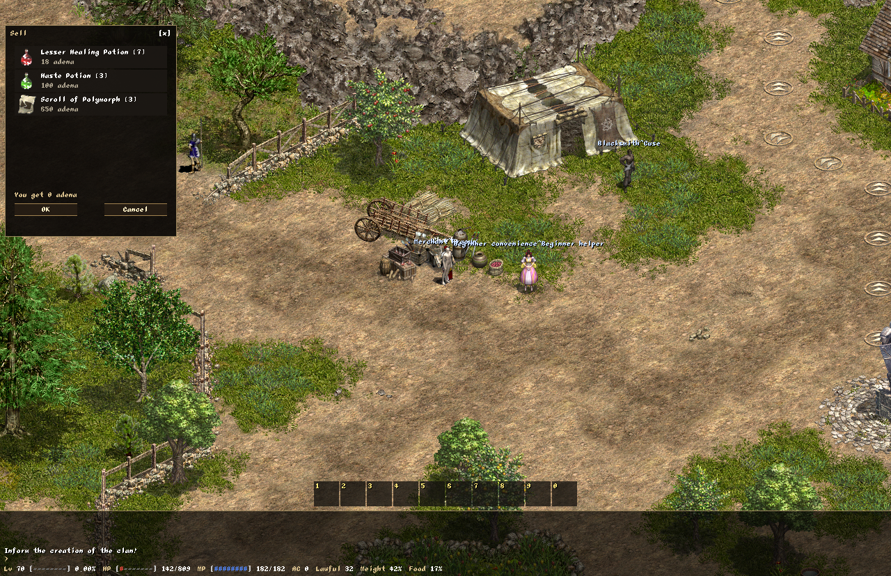 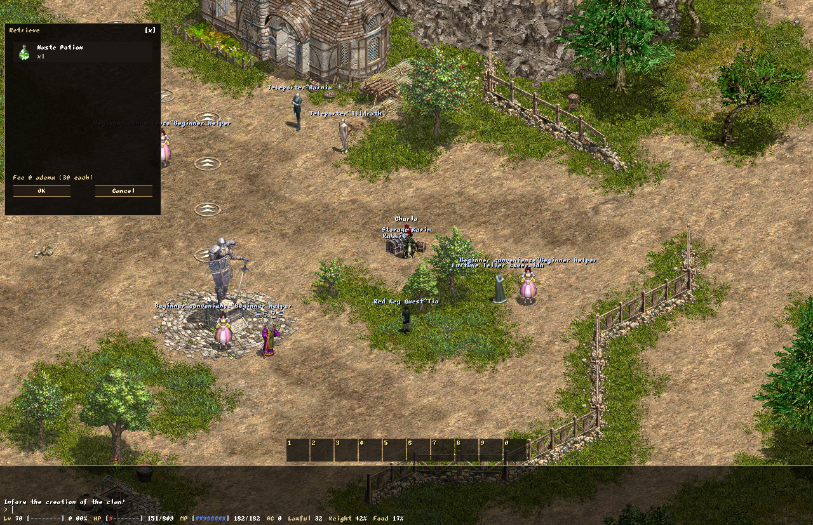 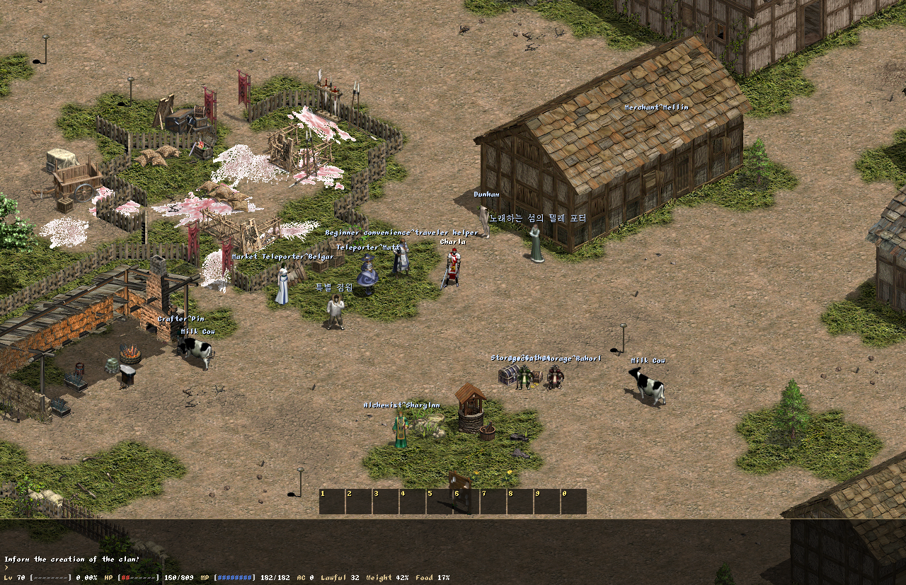

**Hablar con NPCs:**
- **Clic sobre un NPC** (no monstruo, ítem ni personaje): se camina hasta 2 celdas y se le habla (`C_NPCTalk`), aunque se suelte el botón. Ctrl+clic sigue atacando.
- **La página:** el servidor responde con su id (`S_NPCTalkReturn`, con los datos de `<var>`) y se muestra la página `<id>-e.html` de `Text.pak` en el diálogo, arriba a la izquierda, con desplazamiento.
- **Cierre:** con Escape, con [x] o al alejarse más de 6 celdas. El servidor la cierra con una página vacía.

**HTML** (`recursos/html.*`):
- **Qué se interpreta:** un subconjunto, sacado de las 6499 páginas en inglés:
  - `<font fg>`, `<p align>`, `<center>`, `<br>` y entidades;
  - `<a link>` (otra página, sin pasar por el servidor) y `<a action>` (`C_NPCAction`);
  - `` (botones `N.img`, con `N+1` resaltado, y tooltip);
  - `<var src="#N">` (datos del servidor) y `<username>`.
- **Resto:** se ignora.
- **Maquetación:** sin GPU, con corte de líneas por ancho, centrado y vínculos. Un test maqueta todas las páginas.
- **Ejemplo real:** al entrar, el servidor manda "RaiseAttr" (el reparto de puntos de atributo de Charla) y ya se ve con sus vínculos.

**Tienda y almacén** (en la misma ventana):
- **Listas:**
  - comprar: `S_ShopSellList`, con índice, ícono, precio y nombre;
  - vender: `S_ShopBuyList`, que solo trae id y precio; el resto sale del inventario;
  - retirar: `S_RetrieveList`;
  - guardar: lo resuelve el cliente con el propio inventario, sin lo equipado, porque la acción "deposit" no tiene respuesta del servidor.
- **Elegir:** clic suma 1, Shift+clic suma 10 (o todo) y clic derecho resta (con Shift, nada). El pie muestra el total, la adena que se tiene o la comisión del almacén (30 por ítem).
- **OK:** manda `C_Result` (tipo 0 comprar, 1 vender, 2 guardar, 3 retirar; lista de id y cantidad).

**Teletransporte:** el servidor local tiene `SendPacketBeforeTeleport=true`. Manda `S_Teleport` y recién mueve al personaje cuando recibe `C_Teleport`. Antes el cliente no respondía y cualquier teletransporte quedaba trabado (también el del hechizo y los pergaminos).

**Verificado contra el servidor local** (Charla; `--hablar`, `--npc-accion` y `--tienda`):
- **Hablar con Fraoun** (mercader): se camina hasta él y se ve su página; "Weapons" y los demás vínculos cambian de página localmente.
- **Comprar:** 2 Lesser Healing Potion, la fila 0, a 42 cada una. Adena 20 083 → 19 999, pociones 5 → 7. Antes, con 83 de adena, el servidor contestó el mensaje 189 (adena insuficiente).
- **Vender:** 3 pociones. Pociones 7 → 4, adena +54 (3 × 18).
- **Almacén** (Karim, invocado con `.spawn 60007 1 2`):
  - guardar 1 Haste Potion: 3 → 2;
  - retirar: la lista la muestra, se retira (2 → 3) y se cobran 30 de adena.
- **Teletransporte con Illdrath** ("teleport talking silverknight-in"): efecto, `S_Teleport` → `C_Teleport` → mapa 4. Charla aparece en Silver Knight Town. Volvió con `.move`.
- **ASan:** sin errores en el flujo de hablar, navegar y comprar.
- **Tests** (`tests/test_npc.cpp`): `S_NPCTalkReturn` con datos, `S_Teleport`, las tres listas, `C_NPCTalk`, `C_Result` y `C_Teleport`, la maquetación de una página tipo fraoun y las 6499 páginas reales.

**Arreglos posteriores** (al probarlo a mano):
- **Teletransportadores del pueblo de inicio:**
  - **Illdrath:** su página (`illdrath1`, igual en inglés y en coreano) ofrece "llevame a Silver Knight Town" con la acción `teleport hidden-velley-for-newbie`. El servidor de pruebas (L1J-JP 3.63c, más viejo que los datos de esta instalación) tiene esa acción solo para otro NPC (50004), así que el clic no hacía nada.
    - **Arreglo:** en el servidor local, `data/xml/NpcActions/Teleporter.xml` acepta la acción también para Illdrath (`NpcId="50003,50004"`).
    - **Verificado:** hablar → acción → `S_Teleport` → `C_Teleport` → mapa 4.
  - **Barnia, Karen, Asha y Feaena:** llevan solo a su clase (elfos, elfos oscuros, ilusionistas y caballeros dragón). A las demás clases el servidor les manda la página de rechazo; eso es lo esperado.
  - **Beginner helper:** sus páginas por clase y nivel (`tutorp1`… con los teletransportes H a K) no existen en esta instalación. Su página inicial solo tiene "Thank you." (acción "l"), que el servidor no usa. Es una diferencia de datos entre versiones y queda sin arreglo.
- **Mapa que el cliente no tiene** (Asdf quedó "en un estado raro"):
  - **Qué pasó:** Asdf usó el teletransportador a Singing Island (NPC 71035, `teleport si-in`). El servidor lo mandó al mapa 8011, que esta instalación no trae (`map/8011/` no existe). Comparando los bloqueos del servidor con todos los mapas del cliente, ninguno pasa del 76 % (el 2005 con el suyo da más del 95 %).
  - **Cómo se veía:** todo negro, con los NPCs flotando, y sin poder caminar, porque sin el mapa ninguna celda es transitable. Reiniciar tampoco servía: el lugar de retorno de esa isla es la isla misma.
  - **Arreglo en el cliente:**
    - si el servidor manda a un mapa que la instalación no tiene, avisa en el chat;
    - la ventana **Exit** (botón de la puerta en el panel original, "Exit" en la UI simple) tiene "Restart" (`C_Restart`: vuelve al lugar de retorno de la zona, vivo o muerto; el servidor deja el HP en el nivel) y "Quit".
  - **Arreglo en el servidor local:**
    - el teletransporte a Singing Island queda desactivado en `Teleporter.xml`;
    - el lugar de retorno de la isla y sus mazmorras (8011, 85, 87) pasa a Silver Knight Town (`corregir_db.sql`).
    - Asdf se movió en la base al punto de inicio, con HP y MP al máximo (habían quedado 128/63 y 71/56).
  - **Verificado:** `.move` al mapa 8011 → aviso en el chat → Exit → Restart → mapa 4.
- **Hablar con el arco equipado:** con el alcance de 18 celdas del arco, el clic sobre un NPC lo atacaba en vez de caminar hasta él. Ahora a un NPC al que se va a hablar nunca se lo ataca.
- **RaiseAttr** (subir un atributo desde el nivel 51): los vínculos de la página son `raise-str`, `raise-dex`... El servidor no los atiende con `C_NPCAction`: el cliente original los manda como `C_Attr` (opcode 61) con el código 479, un 1 y el atributo ("str").
  - **Ahora:** el cliente los traduce y cierra la página.
  - **Verificado:** con `--subir=str`, la fuerza de Charla pasó de 21 a 22 en la base y llegó `S_OwnCharStatus2`.
  - **Límite del servidor:** vuelve a mandar la página solo al entrar o al subir de nivel, no después de elegir. Así que los puntos pendientes se reparten de a uno por sesión.

**Pendiente o conocido:**
- **Nombres en la tienda:** el servidor manda los nombres de lo que vende tal como están en su base de datos. La del servidor local está en coreano, y así se ven. El cliente original hace lo mismo; con un servidor en inglés llegarían en inglés. En el inventario el servidor manda referencias ("$26") y se ven en inglés.
- **Cantidades:** no hay diálogo para escribir la cantidad; se elige con clics.
- **Otros almacenes y comercios:** almacén de clan, de elfos y adicional, tiendas privadas, fabricación (`S_HowManyMake`) y `S_InputAmount`.
- **HTML:** se ignoran `<b>`, tamaños y caras de letra. No hay páginas en otros idiomas: siempre se usa `-e`.
- **Silver Knight Town:** se ven manchas blancas y rosadas junto a las cercas (piezas del mapa translúcidas). Falta revisar si deberían dibujarse de otra manera.

## Entregable 8: Magia y habilidades ✅

 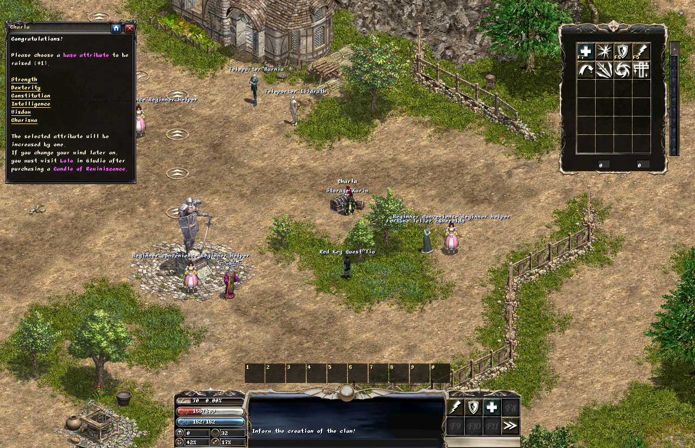 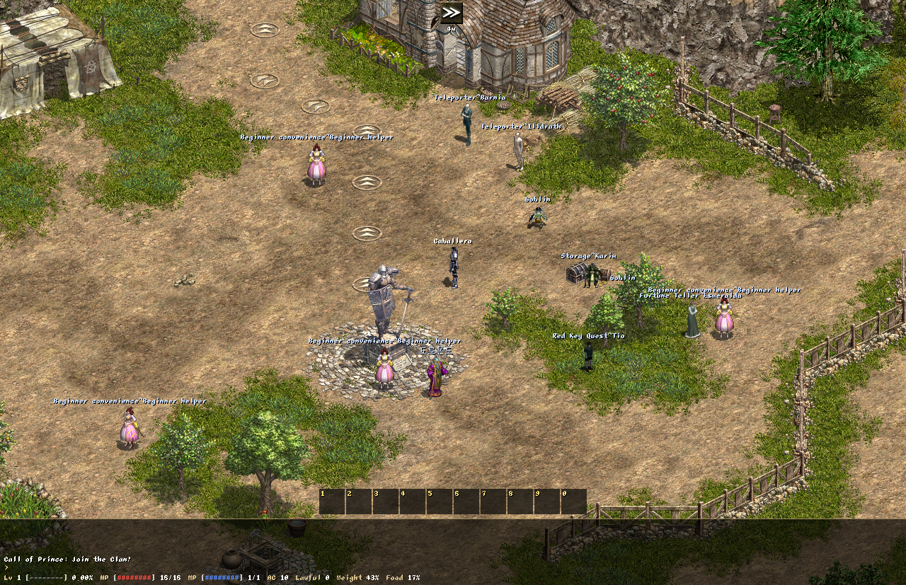

Completa lo que el paso 6.5 había adelantado (lanzar, efectos visuales y aditivos, velocidad con haste y brave).

**Íconos de los efectos activos** (antes, texto):
- **Dónde:** una fila arriba al centro, sobre las ventanas, con el tiempo restante debajo ("5m", "45s"; los minutos redondeados hacia arriba).
- **Detalles:** parpadea en los últimos 10 s; con el puntero encima, el nombre y el tiempo exacto.
- **De dónde sale el ícono:**
  - del hechizo que lo da (`spellicon.idx`), según el paquete: haste o lento, escudos, auras, Holy Walk, Immune to Harm;
  - o del ítem: poción de brave (79), waffle de elfo (130), poción azul (75).
  - Sin ícono, las primeras letras del nombre.

**Ventana de magia original** (Alt+S con la UI original):
- **Partes:**
  - el marco 934 con una grilla de 4 × 6 íconos (celdas de 34 px desde (37, 43), medidas en la imagen);
  - la tira de pestañas 936 + n: niveles 1 a 10 y las habilidades de clase;
  - SP y MR en los recuadros de abajo.
- **Uso:** como la lista de la UI simple. Clic lanza, se arrastra a la barra o a una tecla F, F5–F12 asignan, la ficha se ve con el puntero encima y los íconos se oscurecen sin MP suficiente.
- **Casilleros F5–F12 del panel original** (1019, 2 × 4 de 34 px): muestran los hechizos asignados. Clic lanza, clic derecho vacía, y se les puede soltar un hechizo arrastrado.

**Verificado** (lo que pide el plan, con personajes nuevos y sin GM):
- **Personajes de prueba:** se crearon con `--crear --clase=3` (mago) y `--clase=1` (caballero). Para preparar la prueba fueron GM un momento en la base local (`.addskill` y `.item`); después se les quitó.
- **Maga (nivel 1) lanza Energy Bolt sobre un goblin:** `C_UseSkill`, el servidor responde con la acción 18 e impacto, y el MP baja de 6 a 3. Los íconos de la ventana se oscurecen sin MP.
- **Caballero toma una poción de velocidad:** `S_SkillHaste` de 300 s; el ícono de haste dice "5m" y las pociones bajan de 3 a 2. Camina 24 pasos a 500–509 ms (antes 672), sin avisos del servidor.
- **`.allbuff` con Charla:** seis íconos (haste, poción de brave, dos auras, Burning Weapon, Iron Skin) con sus tiempos.

**Pendiente o conocido:**
- **Teleport:** el hechizo sin marcador no se pudo probar porque Maga no tiene MP suficiente (cuesta 10). Los marcadores (`C_UseSkill` con mapa e id) faltan.
- **Pestañas de la ventana original:** hay tres juegos de tiras (936–946, 947–957, 958–968); se usa el primero para todas las clases.
- **Recuadros de abajo:** que muestren SP y MR es una suposición (la imagen 935 tiene los rótulos "S.power" y "M.resist").
- **Estados sin manejar:** `S_Paralysis` (no bloquea el movimiento), `S_Poison` (sin tinte verde) y `S_CurseBlind` (sin oscurecer la pantalla).
- **Karim:** el enano invocado en el entregable 7 quedó en el punto de inicio y tapa a quien aparece ahí, hasta que se reinicie el servidor.

## Entregable 9: Social ✅

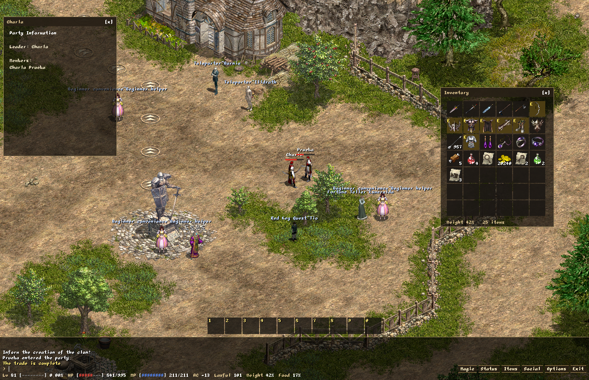 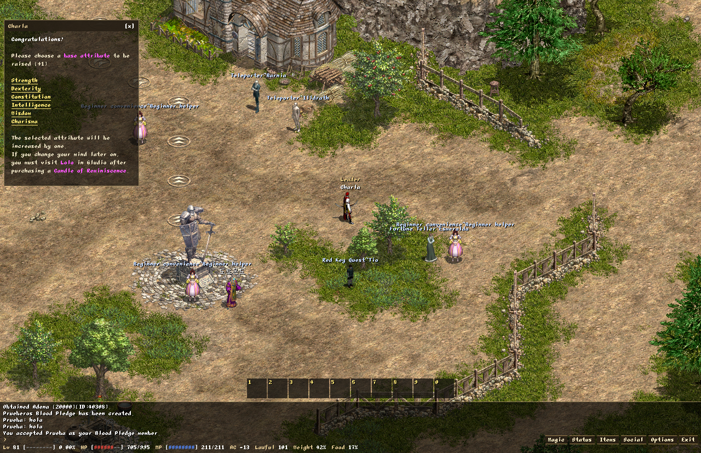 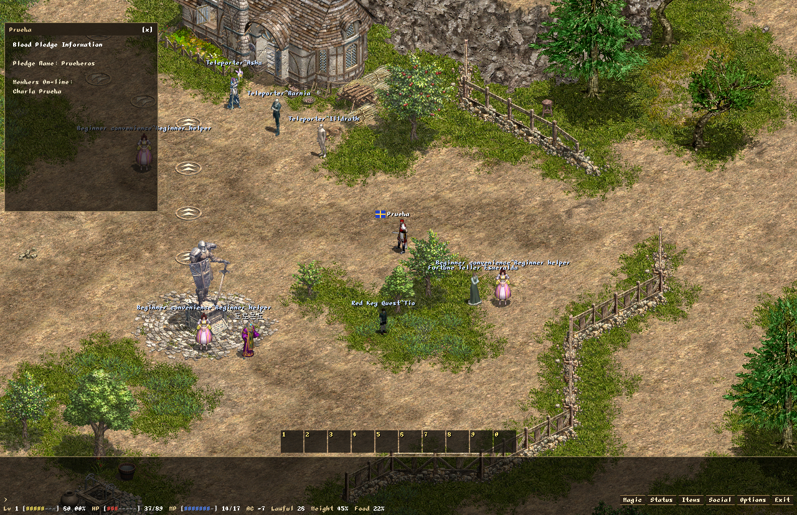

**Preguntas del servidor** (`S_MessageYN`): el texto sale de string-e.tbl con sus argumentos, con botones Yes/No (Enter/Escape). La respuesta va en `C_Attr` (h 0, d número, h tipo, h 1/0).

**Grupo:** `/invite` (o el botón con un personaje marcado) manda `C_CreateParty`; `/party` pide la página "party" (líder y miembros); `/leave` y `/kick`.

**Intercambio:**
- **Cómo empieza:** `C_Trade` no lleva a quién; el servidor elige al que está al lado y enfrente (por eso `--girar`).
- **Ventana:** dos grillas de 6 × 3 (lo propio y lo del otro, con íconos y nombres), OK y Cancel. Después de OK dice "Waiting..." hasta `S_TradeStatus`.
- **Ofrecer:** soltando un ítem del inventario sobre la ventana, o doble clic mientras está abierta. Se ofrece la pila entera.

**Clan:**
- **Comandos:** `/clan` crea (`C_CreateClan`), `/join` pide entrar al príncipe que se tiene enfrente, `/pledge` abre la información, `/leaveclan` y `/banclan`.
- **Página del clan:** `S_Pledge` manda 3 datos (clan, conectados, todos), pero las páginas "pledge" y "pledgeM" leen 5 (`#1` y `#3` son las cantidades). El cliente las cuenta y reordena.
- **Emblema:** se pide una vez por clan con `C_Clan` y llega en `S_Emblem` (16 × 12 píxeles RGB555); se dibuja a la izquierda del nombre. `/emblem` sube uno de muestra (el original lo carga de un archivo).

**Títulos y alineamiento:** el título (`S_CharTitle`) va arriba del nombre. El nombre de los jugadores es azul con alineamiento ≥ 500, rojo con ≤ −500 y blanco en el medio; el objetivo sigue en amarillo.

**Verificado** (dos clientes a la vez contra el servidor local):
- **Grupo:** Charla (`--decir="/invite Prueba"`) invita a Prueba (`--aceptar`), que recibe la pregunta 953 y acepta. "/party" muestra "Leader: Charla" con los dos miembros.
- **Intercambio:**
  - Charla ofrece sus 2 Lesser Healing Potion (`--ofrecer`) y los dos dan OK. Llega `S_TradeStatus` 0 ("The trade is complete").
  - En la base, Prueba pasa de 2 a 4 pociones y Charla queda sin ninguna.
- **Clan:**
  - Charla crea "Prueberos" (adena con `.item`) y se pone el título "Leader", que se ve sobre su nombre.
  - Prueba hace `/join` frente a ella; Charla acepta la pregunta 97 y Prueba entra al clan.
  - "/pledge" de Prueba muestra el clan y "Charla Prueba" como conectados.
  - Charla sube el emblema y Prueba lo recibe por `S_Emblem` y lo ve junto a su nombre.
- **Tests:** decodificación de pregunta, intercambio, título, emblema y página del clan, y bytes de los comandos.

**Pendiente o conocido:**
- **Servidor:** no traía la carpeta `emblem/` y `C_Emblem` fallaba. `arrancar.sh` ahora la crea.
- **Emblema propio:** no hay selector de archivo; `/emblem` sube uno fijo.
- **Al crear o entrar a un clan:** el servidor no reenvía el `S_CharPack`, así que el emblema del propio personaje aparece después de reaparecer (al volver a entrar o teletransportarse).
- **Sin probar:** alianzas, guerras de clan y el reparto automático del grupo.
- **Datos de prueba:** Charla y Prueba quedaron en el clan Prueberos en la base local.

## Entregable 10: Mundo completo ✅

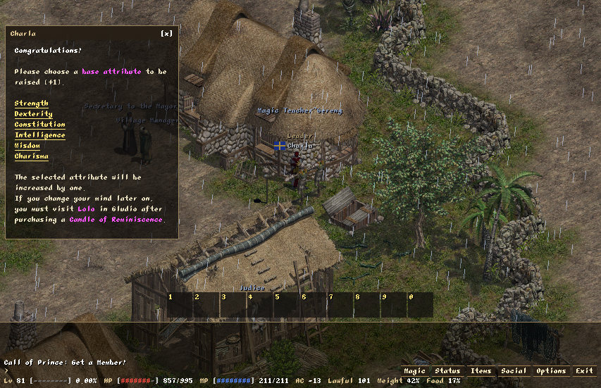 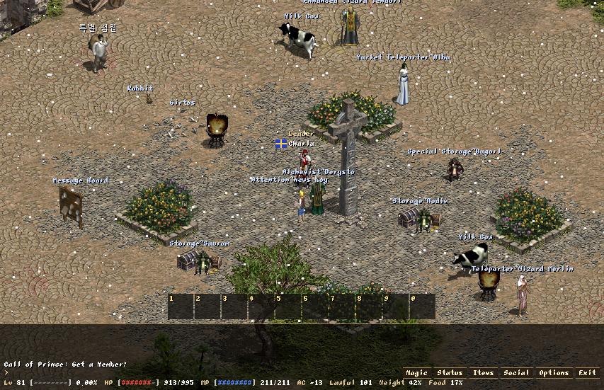 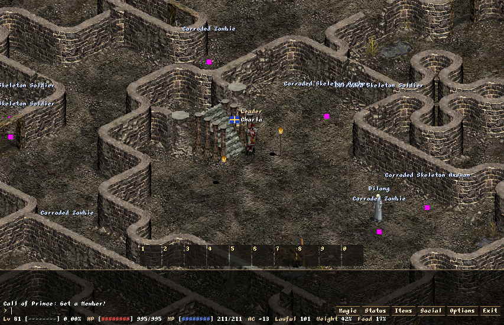 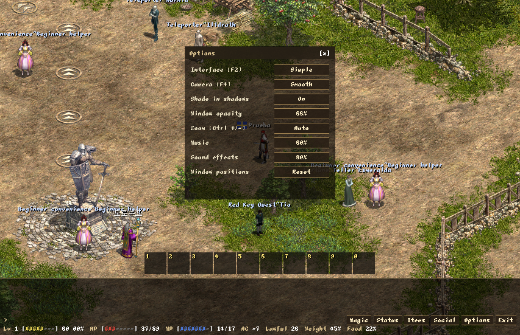

**Audio** (módulo nuevo `src/audio`, sobre SDL3):
- **Arquitectura:** un dispositivo y varios streams que SDL mezcla: música, ambiente y 16 para efectos. Si todos los de efectos están ocupados, se corta el más viejo.
- **Música** (`sound/music<n>.mp3`): se decodifica de a poco con dr_mp3, que es la única dependencia nueva.
  - Fuera del juego suena la del login.
  - Dentro, la de la zona según `music.def` de Text.pak. Vale la primera zona que contiene la posición, así los pueblos ganan al campo que los rodea. Se respeta la pausa `INTERVAL` entre repeticiones.
  - Muerto, el tema "Death".
  - El valle escondido de esta versión (mapa 2005) usa las zonas del 69, del que es copia.
- **Efectos:** los frames de la tabla de sprites con sonido (`[n`, `<n`) suenan al empezar a dibujarse: golpes, daño, muerte y los efectos de hechizos. El volumen baja con la distancia al personaje y es cero a 20 celdas. El mismo sonido no se repite dentro de 60 ms.
- **Ambiente** (`envsound.def`): el sonido en bucle de la zona y, de cada grupo, uno al azar cada tanto. Cambia de día a noche con la hora del juego (noche fuera de 6:00–17:59, como el servidor).
- **Volumen:** música y efectos en la ventana de opciones (de 20 en 20 %, "Off"), guardados en `settings.ini`.
- **`--mudo`:** todo corre igual pero sin volumen. Las pruebas automáticas lo usan, y `--perf` muestra los efectos tocados y la música vigente.

**Clima** (`S_Weather`: 1–3 nieve, 17–19 lluvia; ".weather N" con un GM):
- **Dibujo:** gotas en diagonal o copos que se mecen, más un velo oscuro con lluvia.
- **Sin estado:** cada partícula es función del tiempo y de su número.
- **Dónde:** solo al aire libre (mapas 0, 4, 68, 69, 70 y 2005); en las mazmorras no.

**Portales:**
- **El problema:** el servidor teletransporta si el destino de un paso es un portal de su tabla, pero el mapa del cliente marca casi todas esas celdas como bloqueadas (393 de 1305) y ningún atributo las distingue: el 0x08 lo tienen 39 de 74 portales del mapa 4 y también 3857 celdas que no lo son.
- **La solución:** al intentar entrar a una celda bloqueada vecina, con el teclado o con un clic justo sobre ella, se manda el paso sin moverse aquí (una vez por segundo por celda). Si es un portal, llega el teletransporte. Si no, no pasa nada visible: el servidor toma el origen del paso siguiente del propio paquete.

**F1:** ayuda con todas las teclas. F2–F4 y F5–F12 ya existían (interfaz, depuración, cámara y hechizos asignados).

**Verificado:**
- **Música por zona:** Charla recorrió, con `.move`, Gludio, Kent, Giran, Oren, Silver Knight Town, Woodbeck, Heine, el pueblo élfico, Aden, el Valle del Dragón y las mazmorras de Talking Island y de Gludio. En cada lugar la música cambió a la de la zona (83, 14, 20, 54, 57, 52, 23, 13, 41, 19, 63 y 65), sin avisos.
- **Presupuestos** (`--perf`):
  - CPU de 0,4 a 1,2 ms por frame, con picos de 4,7 ms;
  - 120 fps, salvo el primer segundo de cada mapa (92 fps, con 18–27 ms de decodificación);
  - sin asignaciones de memoria en el frame después de cargar.
- **Combate con sonido:** 8 efectos en un combate. El valle escondido elige la música 53 y Talking Island la 30.
- **Portal:** desde (32477, 32852) un paso al norte entra a la mazmorra de Talking Island (`S_MapID` 1, música 63).
- **Clima:** `.weather 19` y `.weather 3`: lluvia y nieve en Talking Island y Giran, y nada en la mazmorra de Gludio.
- **Tests:** `tests/test_sonidos.cpp` cubre `music.def` y `envsound.def`, de muestra y los reales.

**Prueba de oído:** el usuario confirmó en vivo que la música, el ambiente y los efectos se escuchan bien.

**Monstruos sin sprite** (`tipo_objeto` en `app/npc_ui.cpp`):
- **Qué son:** 30 de los monstruos de la base de esta versión usan un gfx que falta en la tabla de sprites y en los `.pak` (Depraved Soul, gfx 8457, y los de las islas nuevas). Se dibujan como un bloque magenta.
- **Antes:** el bloque era de 8×8 y no se podía elegir. Además, como su gfx no tiene tipo (atributo 102), se lo trataba como un NPC: el clic caminaba hasta él para hablarle.
- **Ahora:** el bloque es del tamaño de un cuerpo (24×36), entra en la lista de cosas clicables, y un gfx sin acciones en la tabla cuenta como monstruo: el clic lo ataca y el cursor es la espada.
- **Verificado:** `.spawn 46186` junto a Charla y un clic simulado (`--arrastrar`): caminó hasta él y atacó (3 efectos de ataque). Captura: `docs/capturas/10_monstruo_sin_sprite.png`.

**Techos y árboles translúcidos** (`dibujar_objetos_mapa` en `app/pantalla_juego.cpp`):
- **Qué hace:** si una pieza de un objeto del mapa (casa, árbol, muro) está delante del personaje y le cubre el centro del cuerpo, todo lo que ese objeto tiene delante del personaje se dibuja translúcido (alfa 110). El interior y la pared de atrás siguen opacos: al entrar a una casa se ve adentro.
- **Silueta:** cuando algo lo tapa, el personaje se dibuja otra vez encima de todo con alfa 120. Varias piezas translúcidas superpuestas casi lo escondían.
- **Objetos:** el `.s32` trae las piezas agrupadas por objeto. Al cargar el segmento se guarda, por objeto, su rango de piezas y su rectángulo de celdas (`ObjetoMapa`).
- **Verificado:** dentro de la posada de Talking Island (32600, 32928) y detrás de una palmera (32589, 32940). Capturas: `docs/capturas/10_techo_posada.png` y `10_arbol_translucido.png`.

**Pendiente o conocido:**
- **Paneo:** los efectos no se panean a izquierda o derecha.
- **Sonidos sin conectar:** los de equipar (`equipsound.def`) y los de la voz del personaje (`charsound.def`) faltan.
- **Mapas "al aire libre":** la lista es fija; otros mapas abiertos (Aden nueva, islas nuevas) no tienen clima.
- **Monstruos sin sprite:** se pueden atacar, pero siguen siendo un bloque magenta: no hay de dónde sacar su dibujo en esta instalación.
- **Transparencia:** es inmediata (sin fundido) y vale para el objeto entero: un muro largo de un pueblo se vuelve translúcido en todo su largo.
- **Monstruos de prueba:** quedaron en el pueblo de Talking Island un Cotrot y un Depraved Soul invocados con `.spawn`; desaparecen al reiniciar el servidor.
- **Personajes al final:** Charla quedó de vuelta en el valle (2005) y el clima del servidor, despejado (`.weather 0`).

## Aprender magia: maestros y libros

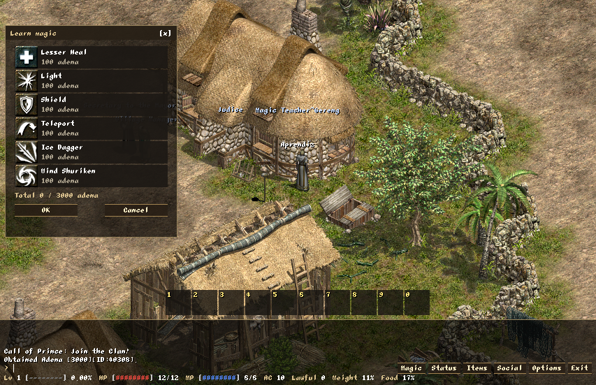

**Maestro de magia** (Gereng en Talking Island, Siriss, Sedia...):
- **Por qué no andaba:** sus páginas tienen el vínculo `action="buyspell"`, que el cliente original no manda como `C_NPCAction` (el servidor lo ignora) sino como `C_SkillBuy` (d NPC).
- **Lista:** el servidor responde `S_SkillBuy` con los índices que todavía no se saben y que la clase y el nivel permiten. Se muestra en la ventana del NPC como una tienda: ícono, nombre y precio (100, 400 o 900 adena según el nivel del hechizo).
- **Compra:** clic elige y OK manda `C_SkillBuyOK` (h n, n × d índice). El servidor cobra, manda el efecto 224 y `S_AddSkill`.
- **Lista vacía:** dice "Nothing to learn now".

**Libro de magia:** se usa como cualquier ítem (doble clic) y ya funcionaba. Las condiciones son del servidor:
- hay que leerlo dentro de un templo: Gludio, Oren o Aden según el alineamiento;
- hace falta el nivel suficiente para el nivel del hechizo;
- un libro del alineamiento contrario se pierde y hace daño;
- un GM lo aprende en cualquier lugar.

**Verificado:**
- **Aprendiz** (mago nuevo en la cuenta GM `prueba2`) le habla a Gereng (`--hablar=Gereng --npc-accion=buyspell`): 22 hechizos en la lista.
- **Compra:** elige Shield y Light (`--tienda=`). En la base pasa a saber 2, 3 y 4, y la ventana de magia los muestra.
- **Libro:** con el de Slow (`.item 40174`, `--usar=Spellbook`), aprende el 29 y el libro desaparece.
- **Charla** (príncipe 81) recibe la lista vacía, porque ya sabe todo lo de su clase.
- **Test:** `S_SkillBuy` y los dos comandos en `tests/test_proto.cpp`.

**Pendiente o conocido:** `action="xchgspell"` (Horun, magia de la torre de marfil) no se probó.

## Ataques con arco

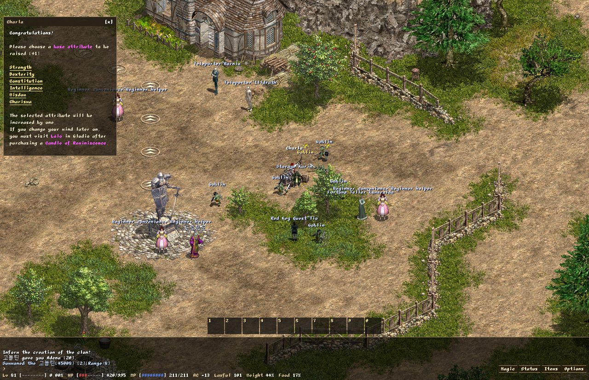

- **Alcance por arma** (`alcance_ataque` en `mundo.h`): el arma sale del estado visual de `S_CharPack` / `S_CharVisualUpdate`, que es el tipo de arma de L1J.
  - **Arco (20) y guantelete (62):** disparan a lo que esté "en pantalla" para el servidor (`L1Attack.calcHit` → `Point.isInScreen`: 18 celdas), sin acercarse.
  - **Lanza (24):** llega a 2 celdas.
  - **El resto:** cuerpo a cuerpo.
  - **Línea de vista:** el servidor también la pide y el cliente no la comprueba; con un obstáculo en medio, el servidor cuenta el disparo como fallo.
- **La flecha:**
  - el servidor responde con `S_UseArrowSkill` (el mismo paquete que el golpe, con el gráfico de la flecha, 66, y las celdas de origen y destino);
  - el proyectil sale en el frame de impacto del ataque con arco (acción 21 = 1 + 20) y vuela hasta el objetivo con su sprite de 8 direcciones;
  - el objetivo muestra el daño cuando llega.
  - Lo mismo vale para los monstruos arqueros (el servidor usa el mismo paquete) y para las púas del guantelete (2989).
- **Verificado contra el servidor local:**
  - Charla con el Ivory Tower Bow disparó a goblins a varias celdas sin moverse;
  - flechas 1000 → 999 → 998, impactos confirmados y un goblin muerto;
  - captura con la flecha a mitad de vuelo (`--captura-proyectil`).
  - **Test:** el `S_UseArrowSkill` real y el proyectil que genera.
- **Para la prueba:** el escudo sellado de Charla no se puede sacar desde el juego, y el arco es a dos manos. Se lo desequipó en la base local.
- **Pendiente:**
  - sin flechas el servidor cuenta el disparo como fallo y no avisa; el cliente tampoco;
  - el arco a dos manos con un escudo puesto da "You cannot take that off" si el escudo está sellado.

## Interfaz: ventanas móviles, transparencia y botones

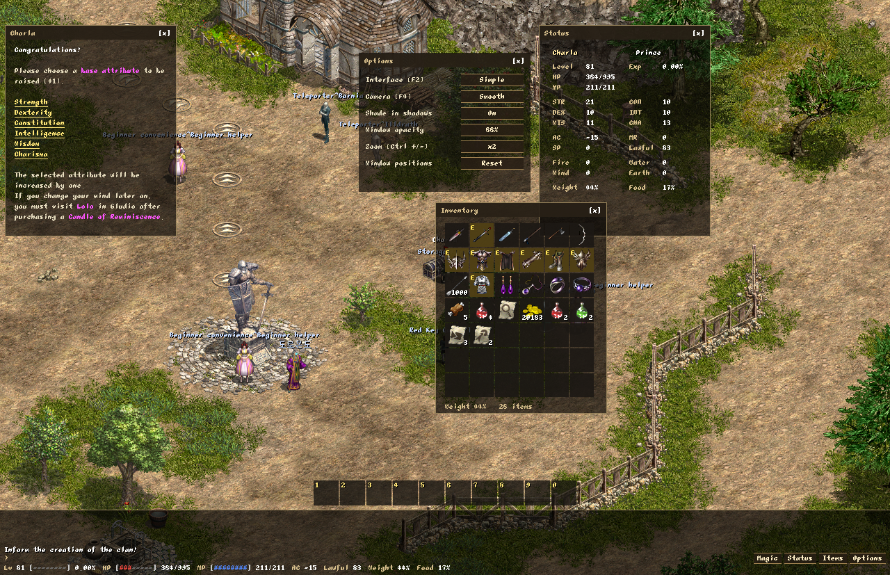 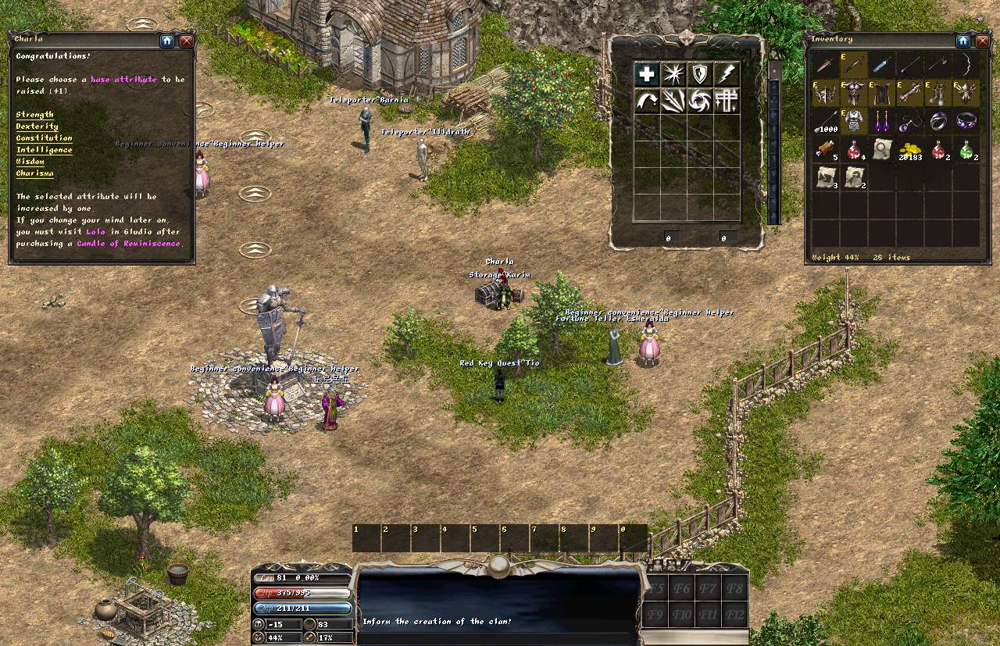

- **Mover las ventanas** (`app/ventanas.cpp`):
  - estado, inventario, hechizos, diálogo de NPC y opciones se arrastran por la barra de título;
  - la posición se guarda en `settings.ini` (`ventanas=`) y se mantiene siempre con el título dentro de la pantalla;
  - las que no se movieron siguen en su lugar de siempre y se acomodan solo junto a las que también siguen en su lugar.
- **Semitransparentes:** el fondo de las ventanas deja ver el juego; el marco y el texto quedan algo más opacos. La opacidad se elige en Opciones (40–100 %; `opacidad_ventanas=` en `settings.ini`, 170 de 255 por defecto). Una ventana que tapa a otra se dibuja con fondo opaco: si no, se leía el texto de la de abajo.
- **Orden entre ventanas** (`actualizar_ventanas` y `dibujar_ventanas`):
  - la que se abre y la que se toca con el clic pasan adelante (`App::orden_ventanas`, de atrás hacia adelante);
  - cada una se dibuja en su propio nivel: mientras se dibuja, `Gpu::nivel_ventana` lleva sus claves de `CAPA_UI` y `CAPA_UI_TEXTO` a `CAPA_VENTANAS` con el nivel por encima de la profundidad, así una ventana tapa entera a las de abajo, texto incluido. Lo que se arrastra va en `CAPA_ARRASTRE`, encima de todo; los diálogos (pregunta, polymorph, F1, muerte), encima de las ventanas;
  - solo la de más arriba bajo el puntero recibe el mouse: a las demás se les esconde el puntero mientras se dibujan (salvo durante un arrastre, que lo resuelve la ventana de donde salió). `sobre_ventana` también es solo la de más arriba;
  - un ítem arrastrado del inventario va al suelo solo si se suelta sobre el mundo, no sobre otra ventana.
- **Sin solaparse al abrir:** si el lugar de siempre de una ventana que se abre tapa a otra abierta, se busca el primer lugar libre, de arriba a la derecha hacia abajo a la izquierda, sobre la barra de atajos (no se guarda; al cerrarla vuelve a su lugar de siempre). Si no hay lugar, queda en el de siempre y adelante. Las que el usuario movió no se tocan.
- **Botones para abrir las ventanas**, además de las teclas:
  - **UI original:** los botones del juego (`1005`, `1007`, `1011` y `1009.img`, con su versión resaltada), en la franja de arriba del panel derecho: magia, estado, inventario y opciones. Con el puntero encima se ve cuál es y su tecla.
  - **UI simple:** botones de texto a la derecha de la línea del chat: Magic, Status, Items y Options.
- **Ventana de opciones:** interfaz (simple u original), cámara, oscurecimiento en la sombra, opacidad de las ventanas, zoom y "Reset" para devolver las ventanas a su lugar.
- **Verificado:**
  - arrastrar el inventario con `--arrastrar=1100,45,700,300` lo mueve, guarda `ventanas=inventario:626,291` y el estado ocupa el lugar que dejó;
  - capturas con las dos interfaces;
  - cinco ventanas abiertas a la vez con 1600×900 lógicos: ninguna se solapa (`docs/capturas/ui_ventanas_sin_solapar.png`); con 1008×552 no entran y se apilan con fondo opaco, y un clic simulado en una parte visible de Opciones la trae adelante (`ui_ventanas_al_frente.png`).
- **Pendiente o conocido:**
  - **Ventana que se abre:** se ve un frame en su lugar de siempre antes de pasar al lugar libre (se detecta al frame siguiente).
  - **Botones del panel original:** su lugar es aproximado (la franja libre del panel). Los otros tres botones de la serie (salir 1013, grupo/intercambio 1015, ayuda 1017) llegan con sus funciones.
  - **Arrastrar a mano:** el arrastre se probó simulado; falta probarlo con el mouse.

## Interfaz: cursores


- **Cuándo cambia** (`app/cursores.cpp`):
  - **mano:** para moverse y sobre la interfaz;
  - **espada:** sobre un monstruo, o con Ctrl sobre otro personaje o NPC (atacarlo);
  - **círculo de objetivo:** mientras un hechizo espera su objetivo.
- **Cómo se dibujan:** son cursores del sistema (`SDL_CreateColorCursor`, con una versión de 64 px para pantallas Retina). Se mueven sin el retraso de un frame que tendría dibujarlos con el juego.
- **Los originales no están en esta instalación:**
  - no hay archivos de cursor en la carpeta del juego;
  - los cursores de `Lineage.exe` son los estándar de Windows (ayuda y flechas de desplazamiento);
  - entre todas las imágenes y sprites chicos de los `.pak` tampoco aparecen.
  - Seguramente van en el código cifrado (`lin.bin`). Estos son dibujos propios en el mismo estilo; si aparecen los originales, se reemplazan los tres dibujos de 16×16.
- **Pendiente:** el cambio de cursor no sale en las capturas (son del juego, no del escritorio), y falta probarlo a mano.

## Rendimiento

Medido con `--perf` (una línea por segundo en el registro; los mismos datos en el overlay F3), Release, ventana 1600×900 en Retina, caminando 20 pasos desde el punto de inicio:

| | Antes | Ahora |
|---|---|---|
| CPU por frame, promedio | ~2,2 ms | ~1,5 ms |
| Peor frame de cada segundo, caminando | 5–9 ms | 1,6–3,2 ms |
| Decodificando en el hilo principal, por segundo | 4–14 ms | 0,2–1 ms |
| Allocations por frame del cliente, en régimen | ~15–30 | 0 (solo al cargar algo nuevo) |

**Medición:**
- La CPU del frame incluye el orden de la lista de dibujo y excluye solo `presentar` (espera del vsync y llamadas al driver). Antes el orden quedaba afuera.
- Allocations: `operator new` instrumentado (`core/asignaciones.cpp`, contador por hilo). Las del driver de Metal dentro de `SDL_GPU` (subir y presentar, ~40 por frame) no se cuentan: no dependen del cliente. Con `--perf` quedan 4 por segundo, las de la propia línea del registro.

**Precarga en un hilo** (`recursos/precarga.*`):
- **El problema era E/S, no CPU:**
  - decodificar un medio tile cuesta 0,3 µs, pero en el cliente salían ~50 µs;
  - los `.pak` están mapeados en memoria (`Tile.pak` 450 MB, `Sprite*.pak` ~5 GB), y la primera lectura de un `.til` o un `.spr` esperaba al disco;
  - eran 20–40 ms en el primer frame de una zona.
- **Ahora:**
  - el hilo principal pide el archivo y sigue dibujando sin él;
  - un hilo trae sus páginas a memoria (`madvise(WILLNEED)` y una lectura por página);
  - uno o dos frames después, el hilo principal lo decodifica ya en memoria;
  - las colas son SPSC sin locks (`AnilloBytes`).
- **No se nota:** el suelo y los objetos del mapa se piden en un margen fuera de la pantalla. Un personaje nuevo aparece un frame más tarde.
- **Siguen en el momento** las imágenes de interfaz, los PNG, los íconos y los glifos: son pocos y van en pantallas fijas.

**Reemplazo LRU del atlas** (`render/atlas.*`):
- **Antes:** con las 8 páginas (128 MB) llenas, lo nuevo dejaba de dibujarse.
- **Ahora:**
  - se recuerda en qué frame se dibujó cada página y, al llenarse, se vacía la usada hace más tiempo;
  - nunca se vacía una página dibujada en el frame actual ni la 0 (blanco, glifos e interfaz);
  - `Graficos` olvida las regiones de la página vaciada y las vuelve a decodificar si se piden.
- **Verificado:**
  - tests con un atlas de juguete;
  - en el cliente con `LIN_ATLAS_PAGINAS=4 LIN_ATLAS_TAM=1024`: 9 reemplazos caminando, la escena completa y sin errores con ASan y UBSan.
- **Medido:** el uso normal del pueblo es de 2 páginas.

**Caché en disco: no se hizo.**
- Decodificar es barato (0,3 µs por tile); lo caro era leer del disco, y una caché en RGBA8 ocuparía el doble que el RGB555 original y también habría que leerla.
- Lo único caro en CPU son los PNG de la selección de personaje (~9 ms en total), una vez, al cambiar de pantalla.

**Segmentos de mapa en un hilo** (`mundo/cargador_segmentos.*`):
- **Antes:** los `.s32` se leían en el hilo principal (0,5–1 ms cada uno); al cruzar a una zona nueva entraban varios en el mismo frame (hasta ~5 ms). Nunca se liberaban: ~100 KB por segmento visitado.
- **Ahora:**
  - el render los pide sin esperar (`segmento_cargado`) y los recibe uno o dos frames después; la lógica del juego (celdas pasables) los sigue cargando en el momento (`segmento`);
  - `actualizar_segmentos`, una vez por frame, guarda los terminados y libera los que quedan a más de 2 segmentos del borde de lo que se dibuja.
- **Objetos del mapa por rectángulo:** el render descarta objetos enteros fuera de la pantalla sin mirar sus piezas. Dibujarlos pasó de ~0,8 ms a menos de la mitad, y paga la comprobación de transparencia.
- **Medido** (Release, 1600×900, `.move` a Gludio y 180 pasos): CPU media 1,13–1,20 ms, igual que antes de agregar la transparencia (1,14 ms; la variación entre corridas es de ±0,07). Peor frame después del segundo 3: 2,3–5 ms (antes 4,25).
- **Memoria:** 12 teletransportes por el continente con el RSS plano en ~160 MB.

**Arenas de textos:** los nombres de los objetos y del inventario se guardaban en arenas que solo crecían (cada cantidad nueva de flechas agrega el nombre). Ahora, pasados 256 KB, se compactan con solo los vivos (`compactar_textos`).

**Fugas:** `leaks --atExit` en una sesión de juego: 415 bloques (26 KB), todos de macOS (conexiones XPC de AppIntents al abrir la ventana); ninguno del cliente.

**Probado y descartado:** un radix sort con los 5 histogramas en una pasada y pares (clave, índice) contiguos no mejoró el orden de la lista de dibujo (dentro de la variación).

**Pendiente o conocido:**
- **Primer frame del juego:** el primer segundo todavía tiene un frame de ~20 ms: las imágenes de la interfaz y el armado inicial.
- **Ritmo de pantalla:** con vsync a 120 Hz quedan ~6 ms de margen en el peor frame medido.

## Tests

```
LINEAGE_DIR=... ./build/debug/lin_tests
[doctest] test cases: 59 | 59 passed | 0 failed
```

Los 2 últimos, en `tests/test_mundo.cpp`: la arena de textos se compacta sin cambiar los nombres, y los segmentos del hilo de carga (iguales a los cargados en el momento, objetos con su rango y rectángulo, y liberación de los lejanos).

El del entregable 9 está en `tests/test_proto.cpp`: pregunta, intercambio, título, emblema, la página del clan (3 datos que pasan a 5) y los bytes de los comandos sociales.

Los 6 últimos:
- en `tests/test_recursos.cpp`: las sombras del mapa 2005 son tiles translúcidos, y el resplandor de los PNG pasa a alfa;
- en `tests/test_atlas.cpp`: estantes, reemplazo de la página usada hace más tiempo y páginas protegidas;
- en `tests/test_asignaciones.cpp`: 10 vueltas de decodificar movimientos y chat de 50 objetos, aplicarlos, interpolar, precarga y atlas, sin una sola allocation (con un control de que el contador cuenta).

Los 7 casos del entregable 4 están en `tests/test_chat.cpp`:
- prefijos de canal y formato de `C_Chat` / `C_ChatWhisper`;
- decodificación de chat normal, grito, sistema, susurro, NPC, mensajes y paquetes de estado;
- anillo del chat, recorte CP949 y globos;
- `string-e.tbl` y `desc-e.tbl` reales;
- porcentaje de EXP y ajuste de línea.

Sin `LINEAGE_DIR` se saltan los tests que necesitan los recursos del juego, como en CI.
