# Lineage Client (C++20 + SDL3)

A new client for Lineage 1. It reads the resources of an original game installation (abandonware) and
speaks the L1J protocol. It implements **deliverables 1 to 10** of the plan
(`docs/analisis/PLAN_CLIENTE.md`): login, character selection and creation, moving in the world, chat
and status, combat, inventory and items, spells and polymorph, NPCs and trading, magic, social features
(party, trade, clan), and the complete world (zone music, sounds, weather and portals). Houses, castles
and sieges, the bulletin board and mail, and player shops are also in.

So far it has been tested **only on macOS** (Apple Silicon). What is missing for Windows and Linux is
marked in the code with `MULTIPLATAFORMA` and listed [below](#missing-for-windows-and-linux).

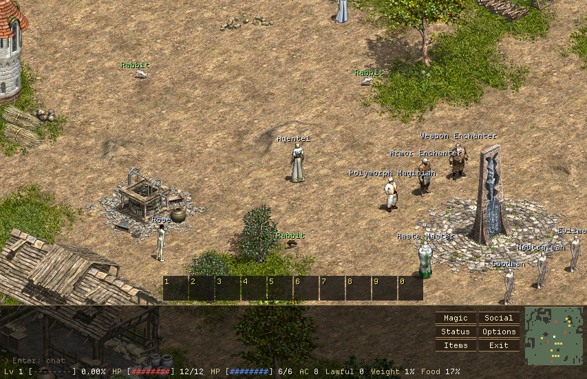

| Simple interface (default) | Original interface (F2) |
|---|---|
| 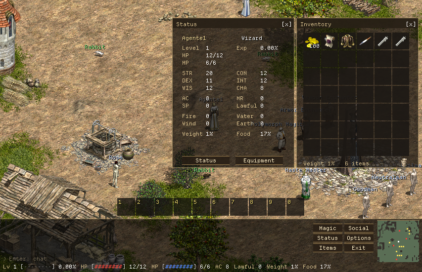 | 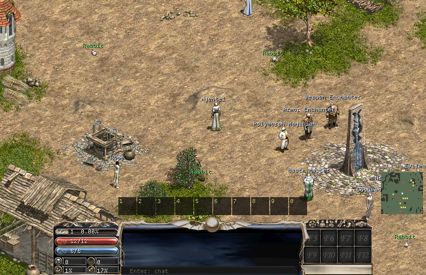 |
| 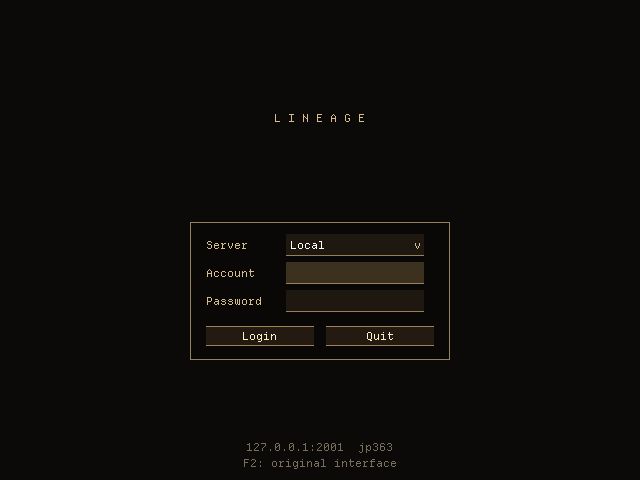 | 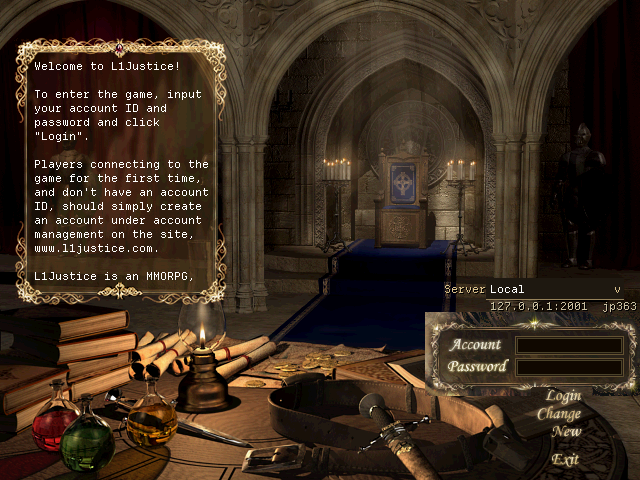 |

| Character selection | Character creation |
|---|---|
| 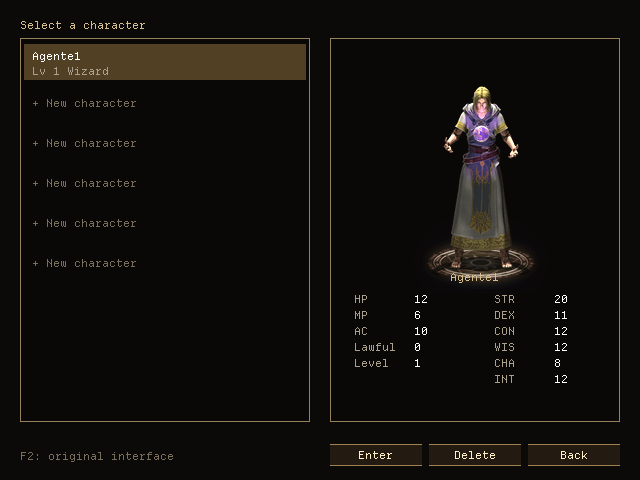 | 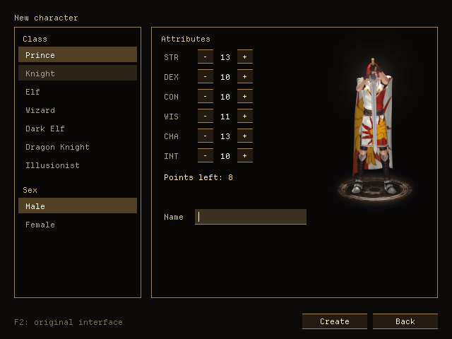 |

More documentation, mostly in Spanish, the working language of the project:

- **[ENTREGABLES.md](ENTREGABLES.md):** detailed status and evidence for each deliverable.
- **[docs/DESCUBRIMIENTOS.md](docs/DESCUBRIMIENTOS.md):** what was learned about formats, timing,
  drawing and the servers, and the design decisions that followed.
- **[AGENTS.md](AGENTS.md):** how to work on the project, for people and agents, also in parallel.

## Requirements (macOS)

- Xcode Command Line Tools (Apple Clang with C++20)
- CMake 3.25 or newer, and Ninja: `brew install cmake ninja`
- The game installation (the folder with `Sprite*.pak`, `Tile.pak`, `Text.pak`, `map/`, `font/`)

SDL3 3.4.18, stb (`stb_image`, `stb_truetype`), dr_mp3 and doctest are downloaded on the first configure
(FetchContent, pinned versions). Nothing else needs installing.

## Build and test

```sh
cd cliente
cmake --preset debug          # or release / debug-asan
cmake --build --preset debug
LINEAGE_DIR="/path/to/game" ctest --preset debug   # without LINEAGE_DIR, tests that need resources are skipped
```

| Program | What it is |
|---|---|
| `build/<preset>/lineage` | The game |
| `build/<preset>/ajustes` | [Settings editor](#settings-editor) |
| `build/<preset>/explorador` | [Resource explorer](#resource-explorer) |
| `build/<preset>/lin_tests` | Tests |

## Local test servers

All development and testing happens against local servers; the real private server is never touched.
Each server has `instalar.sh` (once), `arrancar.sh` and `detener.sh` in its own folder.

| Folder | Server | Port | Protocol |
|---|---|---|---|
| `servidor_local/` | L1J-JP 3.63c (the reference for the tests) | 2000 | `jp363` |
| `servidor_classic363/` | l1j-en/classic, 3.63 branch ([notes](servidor_classic363/README.md)) | 2001 | `jp363` |
| `servidor_classic/` | l1j-en/classic (3.0 English / US 2009) | 2000 | `s3ep1` |
| `servidor_380/` | L1JGO-Whale (3.80C) | 7001 | `tw380` |

```sh
servidor_local/instalar.sh    # once: downloads the server and creates the database in MariaDB (port 3307)
servidor_local/arrancar.sh    # starts MariaDB and the server (Ctrl+C to stop)
servidor_local/detener.sh     # stops MariaDB
```

`servidor_local/instalar.sh` fixes what that 2013 server needs to work with current Java and MariaDB:

- replaces the MySQL 5.1.25 connector with version 5.1.49;
- adds JAXB, no longer shipped with Java;
- uses `zeroDateTimeBehavior=round` for `0000-00-00` dates;
- starts with English language and the `Asia/Tokyo` time zone;
- fixes invalid database rows (`corregir_db.sql`).

Accounts are created automatically on first login (user = password).

`herramientas/prueba_login.py` is a minimal Python client: it goes through login, character list,
creation and entering the game, printing each packet. It helps debugging the server or the protocol.

## Running

```sh
build/debug/lineage
```

The client takes **no command-line parameters**: everything comes from `settings.ini`
(`~/Library/Application Support/Lineage/LineageCliente/settings.ini`) and from the interface.

- **Game folder:** chosen with the native dialog on first launch, then saved (`juego=`).
- **Servers:** chosen in the login menu. There is one per line in `settings.ini`:

  ```ini
  servidor=Local test|127.0.0.1|2000|jp363|account
  servidor=Other|play.example.com|2000|s3ep1|
  servidor_elegido=Local test
  ```

  The fields are name, host, port, protocol version (`jp363`, `s3ep1` or `tw380`) and the last account
  used on that server. The password is not saved. An old `settings.ini` (`host=`, `puerto=`...) is
  converted automatically.

### Settings editor

`build/<preset>/ajustes` edits `settings.ini` in a form with tabs (Game, Interface, Audio, Servers,
Characters), without touching the text file. It uses the same simple interface as the game, writes the
same file and validates numeric fields before saving. In the Characters tab, you can remove a
character's saved shortcuts and bar, and reset window positions. `--config=PATH` edits another file.

Run it while the game is closed: the game saves `settings.ini` too and can overwrite your changes.

| Interface tab | Servers tab |
|---|---|
| 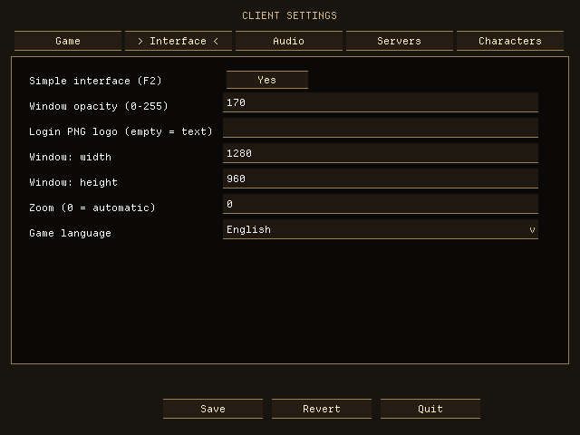 | 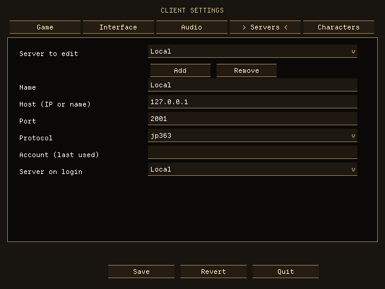 |

### Languages

The interface is available in **Spanish, English, Portuguese, German and French**. Choose it in the
settings editor (Interface tab) or with `idioma=es|en|pt|de|fr` in `settings.ini`. With no value it follows
the system language, and falls back to English if that is not one of the five. The game applies it at
startup; the editor switches as soon as you pick it.

| Español | Português |
|---|---|
| 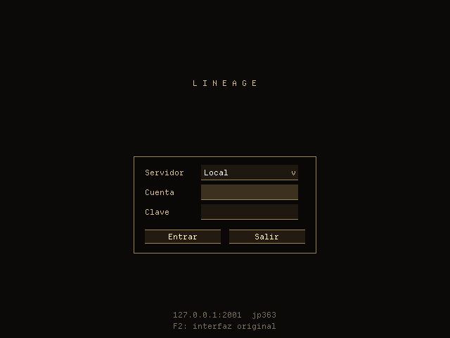 |  |

| Deutsch | Français |
|---|---|
| 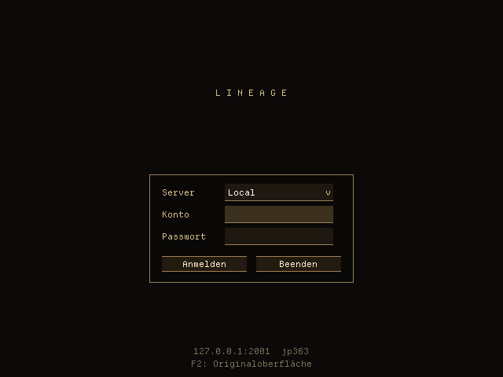 |  |

- **What is translated so far:** login, character selection and creation, and the settings editor. The
  in-game windows are not migrated yet and keep their current text. Text sent by the server is shown as
  it arrives.
- **Translations** live in `src/i18n/catalogo.def`, one line per text with its five languages. The tests
  check that every text has all five and the same `%d` / `%s` in each.
- **Font:** interface text uses [Departure Mono](https://departuremono.com/) (SIL OFL 1.1, see
  `licencias/DepartureMono-OFL.txt`), because the game's bitmap font only has ASCII and Korean. It is
  embedded in the binary and drawn at 11 px, where its pixel grid lands exactly on the screen, without
  smoothing. Text in CP949 (Korean from the server) still uses the original font.
  `tools/generar_fuente_ui.py` regenerates the embedded data (needs `fonttools`).

### Settings reference

All of these can be changed from the editor; most can also be changed in the game.

| Key | Meaning |
|---|---|
| `juego` | Game folder |
| `servidor`, `servidor_elegido` | Server list and the selected one |
| `idioma` | Interface language; empty = the system's |
| `ventana` | Window size (`WIDTHxHEIGHT`), saved on close |
| `zoom` | Game scale; 0 = automatic |
| `ui_simple` | `1` simple interface, `0` original panel (F2) |
| `camara_a_saltos` | `1` camera follows the walking frames, like the original (F4) |
| `sombra_personajes` | Darken characters standing in a tree's shadow (Shift+F4) |
| `pantalla_completa` | Game in full screen (1) or windowed without border (0, default). Alt+Enter toggles it |
| `mostrar_fps` | Show frames per second and milliseconds per frame in the top right corner (Shift+F3) |
| `efecto_luz` | Dark nights and dungeons, with the light of characters, NPCs and items |
| `efecto_agua_tinte`, `efecto_agua_ola` | Underwater blue tint and wave |
| `efecto_infravision` | Green elf vision and dim dark elf vision |
| `opacidad_ventanas` | Window background opacity (0–255) |
| `volumen_musica`, `volumen_efectos` | Volume (0–100) |
| `chat_con_enter` | `1` Enter opens the chat line, `0` always typing |
| `barra_personaje` | HP/MP bar over your own character |
| `texto_dano` | Floating damage and "Miss" over your character |
| `compensar_ataque` | Show your swing at once, without waiting for the server's echo |
| `logo` | PNG for the simple login screen, see below |
| `atajos`, `barra` | F5–F12 spells and shortcut bar, per character |
| `ventanas` | Saved window positions |

**Custom login logo (simple interface):** `logo=my_logo.png`, a PNG with transparency of up to 2048×2048,
as an absolute path or relative to the `settings.ini` folder. It is shrunk to fit 560×190 (best to supply
it at that size, because it is scaled without smoothing). Without a logo, or if it can't be read, the
title is shown as text.

## Controls

**F1** shows all the keys in the game.

### Interface and view

- **F2:** switches between the simple interface (default: a text strip with chat, input and ASCII bars,
  and a text status window) and the original panel with its images. It also applies to login, character
  selection and creation: with the simple interface they are text boxes (a list of all characters with
  their data; deleting asks for confirmation).
- **F3:** fps, CPU per frame (average, worst frame and decoding), allocations of the worst frame,
  instances, draw calls, objects and position.
- **F4:** camera, "smooth" (default: follows the continuous position, with the character centered) or
  "stepped" (like the original: follows the walking frames, a ¼ cell at a time).
- **Shift+F3:** frames per second and milliseconds per frame in the top right corner, on or off.
- **Alt+Enter:** full screen or windowed. Windowed has no system border: the bar on top drags the window, and its
  buttons minimize and close it (on macOS they are on the left, like the system's). Full screen has no bar.
- **Shift+F4:** darken characters standing in a tree's shadow (default) or not.
- **Shift+F12:** saves `captura.bmp`.
- **Shift+click on the world:** turns the character that way without walking (to face someone, e.g. to trade).
- **Ctrl/⌘ + and Ctrl/⌘ −:** zoom in and out (integer scale; zooming out shows more map).
- **Ctrl/⌘ 0:** automatic zoom, the largest that fits 640×480.
- **Game view:** adapts to the window. Enlarging it shows more map, with the panel centered at the
  bottom. The login and character screens stay at 640×480.
- **Windows:** drag the title bar to move them (the position is saved). They look for a free spot when
  opened; if they overlap, a click brings one forward and only that one gets the mouse. They also open with
  buttons: those of the original panel, or the text ones to the right of the chat (simple interface).
- **Options** has the interface, camera, shade, FPS counter, full screen, light and water effects, elf vision, window opacity, zoom, music and effects volume, and
  a "Reset" for window positions.
- **Welcome text and server news at login:** wrapped to fit; the mouse wheel or Page Up / Page Down scrolls them.
- **Esc:** at login, quits.

### Moving

- **Walk:** hold the left button to walk toward the pointer, or use the arrow keys (combine them for diagonals).
- **Doors:** click a door to open or close it (the character walks to it). Closed doors block the way.
- **Portals:** to enter a dungeon or climb stairs, walk toward the entrance with the arrows, or click right on it.
- **Roofs and trees:** when you enter a house or pass behind a tree, whatever covers the character becomes
  translucent and its silhouette shows.
- **Change character:** Exit > "Character select".

### Combat

- **Attack:** click a monster and hold. The character walks to it and attacks at the pace of its attack
  animation, even if the camera moves and the pointer is no longer over it (the target is fixed when
  pressing). Releasing stops. The target's name turns yellow.
- **A** (chat closed): keeps attacking the target, or the monster under the pointer, until it dies, you walk
  with the arrows, or you click elsewhere.
- **Force attack:** Ctrl+click (or ⌘+click) attacks an NPC or another player. A plain click only attacks monsters.
- **PK mode:** `/pk` in the chat toggles it (a red "PK" indicator at the top right): clicking another
  player attacks without Ctrl. This is client-side; the server decides whether the attack counts (it does no
  damage in safe zones).
- **Monsters without a sprite:** those missing from this installation show as a magenta block and are
  attacked like any other.
- **On death:** a notice appears with a **Restart** button, which sends `C_Restart`.
- **Status effects:** poisoned (green), frozen (gray), blind (black screen except your own character), and a
  notice at the top if paralyzed, asleep, stunned or bound (you can't move or act).

### Items

- **Alt+I:** opens and closes the inventory.
  - Shows the original icons (`N.tbt`), the name on hover, equipped items with an "E", and the weight.
  - Double-click uses an item: equips or removes weapons and armor, drinks potions.
  - Drag an item out of the window to drop it on the ground.
  - **Item details:** hovering shows the name and, if identified, its attributes (damage or defense,
    material, weight, enchantment, classes that use it, attribute bonuses, MR, resistances...). Otherwise it
    says "Unidentified".
  - **Scrolls used on another item** (identify, enchant weapon or armor): double-click the scroll, then click the
    item; Esc cancels.
  - **Trash can** (bottom right of the inventory): drag an item onto it to destroy it, for what can't be dropped
    or sold. It always asks first: how many from a stack, or to confirm a single one. The server rejects equipped
    and undeletable items.
- **Items on the ground:** click one to pick it up; if it is far, the character walks to it. The name shows on hover.
- **Giving items:** drag an item from the inventory onto an NPC or pet; from a stack, it asks how many.
- **1..0 (or Alt+1..Alt+0):** shortcut bar (bottom center). Drag a spell (from Alt+S) or an item (from Alt+I) onto
  a slot. Clicking it, or its number or Alt+number, uses it; right-click empties it; dragging between slots moves
  it. Middle-click on a slot selects it (gold frame), and the middle button on a character or monster uses the
  selected spell there; held, it repeats each time the wait ends (for an item, every half second). Spell slots
  (bar and F5–F12) show the wait until the next spell: a shrinking shade and the seconds left. Saved per character.

### Magic

- **Alt+S:** spell window (click casts; with the pointer over a spell, F5–F12 assigns it to that key).
- **F5–F12:** cast the assigned spell (saved per character). A spell with a target waits for a click on the target;
  right-click cancels.
- **Learning magic:** at the magic teacher (Gereng on Talking Island...), "Learn magic" opens the list: click
  chooses and OK buys. Spellbooks are used with a double-click inside a temple.

### NPCs and trading

- **Clicking an NPC:** walks to it and talks (its page appears at the top left; Esc closes it). In a shop or warehouse:
  click adds 1, Shift+click adds 10, right-click subtracts; OK confirms.
- **Repairing weapons:** at a blacksmith, the repair link shows damaged weapons with their cost; a click repairs.
- **Pets and summons:** their list is to the left of the shortcut bar, with their health. Clicking a name opens its
  orders menu (attack, defend, stay...); "Bag" shows its inventory, where a click uses or equips the item. With
  "Attack", the next click picks its target.
- **Player shops** (in the market rooms): clicking a seller (seated, with the title above) shows what they sell and
  buy; clicking a line asks how many. `/shop Title` sets up your own: click an inventory item to set its price;
  "Open" opens it and `/shop` again closes it.
- **Town bulletin boards:** click the board: topics, reading, "Write" posts (300 adena), and authors can delete theirs.
- **Mail:** `/mail` (Inbox, Clan and Saved; "Write" to a character for 50 adena, or to the whole clan).

### Chat and social

- **Chat:**
  - **Enter opens the chat line** (the bottom says "Enter: chat"). Type, and Enter sends and closes it; Esc clears
    and closes it. While closed, keys are actions (1–0 use the bar). In Options, "Chat: Always typing" goes back
    to always typing, with the bar on Alt+number;
  - mouse wheel over the panel, or Page Up / Page Down, for older messages;
  - prefixes: `!` shout, `&` global, `$` trade, `@` clan, `#` party, `%` alliance, `*` chat group, `"name text` whisper.
- **Alt+C:** opens and closes the status window (left of the inventory if both are open).
- **Social** (button, or the one on the original panel): party, trade and clan, with buttons and help. Server
  questions (invitations, trade or clan requests) appear with **Yes/No** (Enter/Esc).
- **Trade:** stand next to the other player, facing them. Drag an item from the inventory to the window (or double-click
  with the trade open), and OK when both agree.
- **Party:** at mid-height on the left, the list of other members with their health; the leader has a "*".
- **Names:** blue with alignment ≥ 500, red with ≤ −500; the title above and the clan emblem to the left.
- **Bookmarks:** `/bookmark name` saves the place (if the map allows it) and `/delbookmark name` deletes it. With
  bookmarks, the teleport scroll and Teleport ask for the destination.
- **Chat commands:** anything that isn't a command goes to the chat.

| Area | Commands |
|---|---|
| Party | `/invite Name`, `/party`, `/leave`, `/kick Name` |
| Trade | `/trade` |
| Clan | `/clan Name` (create; prince with 30000 adena), `/join` (facing a prince), `/pledge`, `/leaveclan`, `/banclan Name`, `/emblem` (uploads a sample emblem) |
| Players | `/title [Name] Title`, `/who [Name]`, `/exclude Name` (block or unblock; no name: the list) |
| Friends | `/buddy`, `/addbuddy Name`, `/delbuddy Name` |
| Chat group | `/chatparty`, `/chatoutparty`, `/chatbanish Name` |

### Sound

Zone music, animation effects and ambience. Music and effects volume are in **Options**.

## Live control (tests and screenshots; development only)

The `debug` and `debug-asan` builds (CMake option `LIN_CONTROL`) open a Unix domain socket and take one-line
commands. The `release` build doesn't include it: a CMake step (`cmake/sin_control.cmake`) fails if it slips in.

- **Socket:** `$LIN_CONTROL`, or `$TMPDIR/lineage-control-<pid>.sock`. The path is printed at startup.
- **Responses:** each ends with `ok` or `error <reason>`.
- **Waits:** commands that wait for something (`login`, `personaje`, `esperar`, `captura`) respond when it
  happens or the time limit passes, without blocking the game.
- **Encoding:** text goes in CP949, like the game's.
- **`LIN_CONFIG=/tmp/x.ini`** (development only): uses another `settings.ini`, so as not to overwrite the user's and
  to run several clients at once.

| Commands | What they do |
|---|---|
| `ayuda` | Lists the commands |
| `estado`, `objetos [radio]`, `inventario`, `html`, `ventanas`, `grupo`, `chat [n]`, `paquetes [n]` | Queries: screen, view and character (and sieges), nearby objects (id, name, gfx, cell and screen position), items, the NPC page with its links, open windows (and where the movable ones are), the party, the chat, the latest packets |
| `login <account> <password> [server]`, `personaje <name>`, `crear <name> <class>` | Enter (they wait for the character list or for being in the game) |
| `decir "text"` | As if typed in the chat (`/` commands and the GM's `.` included) |
| `hablar <obj>`, `atacar <obj>`, `parar`, `clic-objeto <obj> [der]` | `<obj>`: id, `#gfx` or part of the name (the nearest one) |
| `accion <link>`, `responder si\|no\|"text"`, `cantidad <n>` | NPC page, server questions, quantity dialog |
| `usar <item> [sobre <item>]`, `soltar`, `dar <item> <obj>`, `borrar`, `lanzar <spell> [obj]` | Items and spells |
| `girar <0-7>`, `ofrecer <item>`, `aceptar-intercambio`, `cancelar-intercambio` | Trade between two clients |
| `abrir\|cerrar inventario\|estado\|hechizos\|opciones\|social\|salida\|teclas` | Windows |
| `clic <x> <y> [der\|medio]`, `arrastrar x1 y1 x2 y2`, `mantener x y frames`, `tecla <name>` (`ctrl+`, `alt+`, `shift+`), `texto "..."`, `ctrl on\|off` | Raw input (logical coordinates) |
| `esperar pantalla=\|paquete=\|html=\|ventana=\|dialogo=\|chat=\|frames=\|ms= [plazo=ms]` | Wait for something instead of counting frames (`paquete=` and `chat=` also count what arrived since the previous command) |
| `captura <path.bmp>`, `mudo on\|off`, `traza on\|off`, `traza-html on\|off`, `perf on\|off`, `depuracion on\|off`, `salir` | Screenshots and debugging |
| `forzar-hora <seconds 0-86399>\|off` | Fix the time of day for light and ambient sound, for tests |

`herramientas/lin_ctl.py` uses it from the terminal (`lin_ctl.py <socket> estado`, or interactively) or as a module
for writing tests.

**Live tests** (`herramientas/pruebas/`):

- one per topic: login, moving, chat and status, combat and spells, inventory, equipment, NPC, bulletin board and
  mail, auctions, social (two clients);
- **those that modify and restart the local server:** houses, castles and war. They restore it themselves with
  `herramientas/pruebas/servidor.py`.

```sh
herramientas/pruebas/todas.py /tmp/test.ini /tmp/screenshots              # those that leave no changes
herramientas/pruebas/todas.py /tmp/test.ini /tmp/screenshots --servidor   # all of them
herramientas/pruebas/npc.py /tmp/test.ini /tmp/screenshots                # just one
```

The test `settings.ini` needs `juego=`. Each test puts characters back where they were and closes its clients even
if it fails. For example, the beginning of `subastas.py`:

```python
c = Control.arrancar(config="/tmp/test.ini")
c("mudo on"); c("login prueba2 prueba2"); c("personaje Charla")
c("hablar Auction"); c("esperar ventana=subastas")
c("captura /tmp/auctions.bmp"); c.cerrar()
```

## Resource explorer

```sh
build/debug/explorador --juego="$LINEAGE_DIR" --gfx=0 --accion=3   # ←/→ gfx, ↑/↓ action
build/debug/explorador --juego="$LINEAGE_DIR" --png=814            # a single image (--img=N)
```

Shows a gfx in the 8 directions over reference diamonds. It was used to calibrate the sprite anchor.

## Structure (data-oriented design)

Identifiers and comments in the code are in Spanish.

| Module | Contents |
|---|---|
| `src/core` | Types, `Arena` (per-frame linear allocation), `MapaHash` (open addressing), `TablaSoa` (columnar table with swap removal), `AnilloBytes` (lock-free SPSC queue), bounded binary reader |
| `src/plataforma` | Memory-mapped files, TCP socket and configuration. Only this module, `render` and `audio` depend on the system or on SDL |
| `src/i18n` | Interface languages: the text catalog and `tr()` |
| `src/proto` | Encryption, opcode tables per protocol version, decoder with a function-pointer table (packet → POD `Evento`), commands and network threads (reader and writer) |
| `src/recursos` | `.idx/.pak` (lookup by name hash in `SpriteNN.pak`), `Text.pak` DES, `.img`/`.png` (including the obfuscated PNG), `.til`, `.spr` (composite frames), sprite table, `.s32`, `eng.fnt`/`kor.fnt` fonts and the interface font, text tables |
| `src/mundo` | SoA object table, player state, map segments and batched event application. Interpolated position and animation frame are pure functions of time. `chat.h`: fixed-size ring log, bubbles, server messages with `string-e.tbl`, and channel prefixes |
| `src/render` | SDL_GPU: atlas in a *texture array*, draw list with radix sort and **a single instanced draw call per frame**; integer scaling |
| `src/audio` | SDL3 device and streams: MP3 music (dr_mp3), WAV effects, ambience |
| `src/ui` | Immediate-mode UI: image buttons (N/N+1), text boxes, simple-interface controls |
| `src/app` | Main loop, screens (login, characters, creation, game) and one `*_ui.cpp` per game feature |
| `tools/` | `ajustes.cpp` (settings editor), `explorador.cpp` (resource explorer), `generar_fuente_ui.py` (embedded font) |
| `tests/` | doctest: core, encryption (vectors from `docs/analisis/scripts/lineage_proto.py`), DES, protocol, real resources, map against the server, world, chat, fonts and texts |
| `datos/` | `sprite_table.txt` (sprite action table from l1j-client, GPLv3; this installation only has an encrypted `list.enx`) and the interface font |

## Known issues

- **Text overflow after the font change, partly fixed.** Departure Mono is 7 px per letter, against the original's 6.
  The F1 help window, the Options window, the editor's buttons and labels, and the login labels were adjusted to fit
  (the editor's labels are checked in `tests/test_textos.cpp`). The other in-game windows have not been reviewed one by one.
- **Partial translation:** the in-game windows are not translated yet ([Languages](#languages)), and the translations
  have not been reviewed by native speakers.

| F1 help | French editor |
|---|---|
| 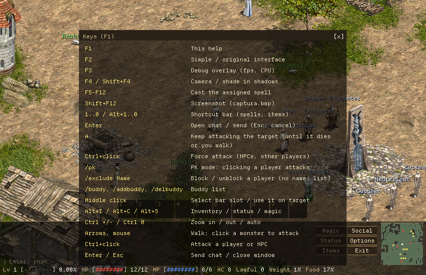 | 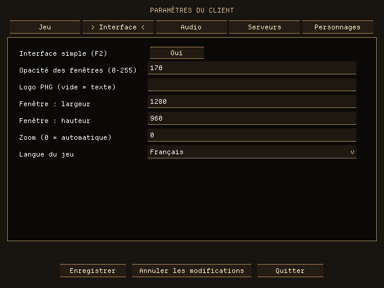 |

## Missing for Windows and Linux

`grep -rn MULTIPLATAFORMA` lists them in the code.

| Where | What's missing |
|---|---|
| `src/render/gpu.cpp` | The shader is in MSL (Metal). Write it in HLSL, compile it with SDL_shadercross to SPIR-V (Vulkan/Linux) and DXIL (D3D12/Windows), and choose the format with `SDL_GetGPUShaderFormats()` |
| `src/plataforma/archivo_mapeado.cpp` | Windows: `CreateFileMappingW` / `MapViewOfFile`, and UTF-8 → UTF-16 paths (`_wfopen`). Currently an `#error` |
| `src/plataforma/socket.cpp` / `socket.h` | Windows: Winsock2 (`WSAStartup`, `closesocket`, `SOCKET` type). Currently an `#error`. Linux is already covered (POSIX and `MSG_NOSIGNAL`) |
| `src/plataforma/rutas.cpp`, `src/mundo/mundo.cpp` | Linux is case-sensitive: look for `Sprite.pak`, `map/`... ignoring case |
| `CMakeLists.txt` | MSVC: equivalent options are in place, untested. `.app` / `.exe` / AppImage packaging (deliverable 11) |
| `servidor_local/*.sh` | Linux: system packages instead of brew. Windows: the server's own `.bat` files |

## License

The format code was written by reading l1j-client (GPLv3), and `datos/sprite_table.txt` comes from that project, so
this client must be distributed as **GPLv3** ([LICENSE](LICENSE)). The interface font, Departure Mono, is under the SIL
Open Font License 1.1 (`licencias/DepartureMono-OFL.txt`). Game resources are not included: they are read from the
user's installation.
