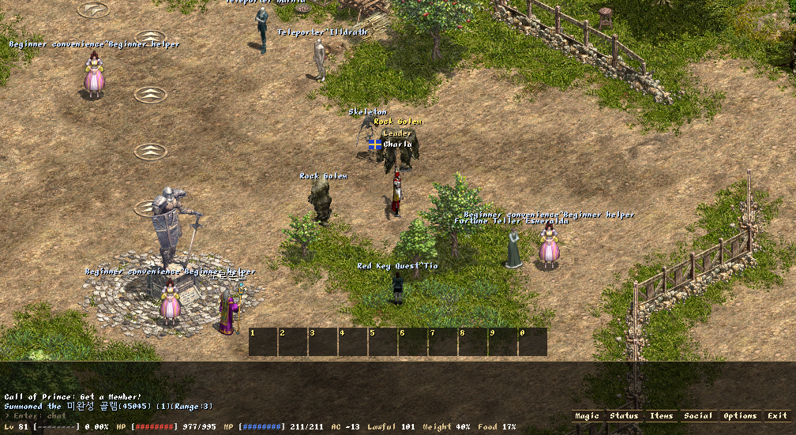
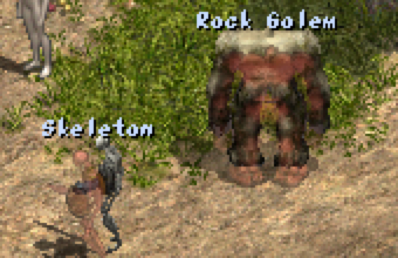

# Plan: sprites y modelos 3D en el mismo cliente

Objetivo: que cualquier gfx pueda dibujarse con un modelo 3D animado en lugar de su sprite, gfx por
gfx, sin tocar el protocolo ni la lógica del juego, y que los modelos se muevan con animaciones
continuas (interpoladas, con transiciones y giros suaves) en vez de frames fijos. Lo que no tenga
modelo se sigue dibujando como hoy.

Parte de lo que probó la sesión **client-3d** en `Lineage Justice/prueba_3d/` (fuera del repo):
- modelos low-poly (~2000 triángulos) generados desde las 8 direcciones de un sprite con
  Hunyuan3D-2mv, con la textura sacada de los píxeles del propio sprite;
- rig de 17 huesos y 5 animaciones (caminar, atacar, daño, quieto, morir) hechos con Blender en
  modo script, para el esqueleto y el caballero (`salida/animacion/*_animado.glb`);
- glTF 2.0: +Y arriba, el modelo mira a +Z, ~2 unidades de alto, claves LINEAR a 30 fps;
- recomendación: cámara ortográfica fija en el ángulo del original y el modelo como reemplazo del
  sprite por gfx, con el sprite como respaldo.

Lo que el cliente ya sabe y este plan respeta está en [../DESCUBRIMIENTOS.md](../DESCUBRIMIENTOS.md).

---

## Estado: MVP en la rama `agente/modelos-3d`

 

Hecho (fases 2 y 3, y parte de la 4), con el esqueleto (gfx 30) y el gólem (gfx 49):
- **Contenido:** el esqueleto animado de client-3d y el gólem, animado con el mismo proceso
  (`prueba_3d/salida/animacion/golem_rig.json`: articulaciones ubicadas a partir de las medidas de
  la malla, ataque de puño). En la máquina del usuario, en `Lineage Justice/modelos/` con
  `modelos.txt`: `gfx archivo giro sentido elevación px_por_unidad` (registro de cámara de
  `prueba_3d` y escala medida contra el sprite con `escala_comun`).
- **Carga y poses** (`recursos/modelo.*`, cgltf v1.14): malla con skin, textura PNG embebida, clips;
  muestreo continuo (lerp / slerp), mezcla, matrices de huesos sin asignaciones. Tests con el `.glb`
  real (`LINEAGE_MODELOS`).
- **Render** (`render/gpu_modelos.cpp`): una capa extra del atlas (`PAGINA_MODELOS`, fuera del LRU)
  con 16 ranuras de 512×512; un pase previo con profundidad dibuja cada modelo con skinning en el
  vertex shader (MSL); la ranura entra a la lista de dibujo como un frame.
- **Animación** (`app/modelos.cpp`): clip según la acción (morir detenido al final, ataque y daño
  estirados a la duración del sprite, caminar un ciclo cada dos pasos sin cortes, quieto), transición
  de 150 ms, giro gradual (90° en 100 ms), posición continua.
- **Encaje:** orden con el mapa, tintes, silueta, ceguera, rectángulo para el mouse y el nombre, y la
  sombra del sprite en el suelo. Shift+F2 alterna modelos y sprites.
- **Calibración:** el ancla es la del registro de `prueba_3d` (borde de abajo y centro de la caja
  proyectada en cada dirección); con `LIN_MODELO_SPRITE=1` el sprite se dibuja encima en rojo: el
  gólem coincide en pies y tamaño.
- **Medido** (Release, 1600×900): con 3 modelos en pantalla, 0,7–0,9 ms de CPU por frame (igual que
  sin modelos), 120 fps, sin asignaciones nuevas; atacando al gólem, 3 ataques sin "Overspeed".

Pendiente: sonidos de las animaciones en el modelo, armas enganchadas, polymorph, refresco de los
lejanos a menor ritmo, la elección "pixel-art / alta definición", más modelos y la prueba a ojo de la
suavidad (videos a 120 fps).

## 1. Lo que no se puede romper

1. **Los tiempos los manda el sprite.** El servidor mide caminar, atacar y lanzar con la duración de
   la animación del sprite (anti-acelerador, §2 de DESCUBRIMIENTOS). Un modelo 3D no cambia esos
   tiempos: sus clips se estiran o encogen a la duración de la acción del sprite, y el momento del
   golpe (frame `!`) se traduce a un instante del clip.
2. **El orden de dibujo.** Todo se ordena con la clave de profundidad del mundo isométrico (pie del
   objeto, piezas de los objetos del mapa) y se dibuja en una llamada. Un modelo debe quedar
   delante o detrás de árboles, casas y otros personajes exactamente como su sprite.
3. **Lo que ya funciona sobre los sprites:** techos y árboles translúcidos con silueta, ceguera,
   tinte de veneno/congelado/sombra, nombres, barras de vida, selección con el mouse
   (`en_pantalla`), cursores, efectos de hechizos encima.
4. **Cero asignaciones por frame** y el presupuesto de CPU (hoy ~1,2 ms por frame en Release).
5. **No redistribuir arte del juego:** los modelos se derivan de los sprites de NCSoft. No van al
   repo: se generan en la máquina del usuario y el cliente los lee de una carpeta configurable
   (como los `.pak`).

---

## 2. Decisión principal: el modelo se dibuja como un sprite ("impostor")

Cada frame, cada modelo visible se dibuja en 3D en una textura propia (con su buffer de
profundidad), y esa imagen entra a la lista de dibujo **como si fuera el frame de un sprite**, con la
misma clave de orden, color y mezcla.

**Por qué así y no un pase 3D directo en la escena:**
- El orden con el mundo 2D sale gratis: el impostor es una instancia más del radix sort. Un pase 3D
  con buffer de profundidad necesitaría darle profundidad a cada sprite y pieza de mapa, que no la
  tienen (el orden isométrico usa columnas vecinas, no un z real).
- Funciona sin cambios con todo lo de §1.3: el impostor tiene rectángulo (selección, nombres),
  alfa (translucidez, silueta) y color multiplicativo (tintes).
- Se puede dar el mismo aspecto pixelado que los sprites: se renderiza a la resolución lógica ×
  escala, con muestreo "nearest", o a la resolución del sprite si se quiere que no desentone.
- Una sola llamada para todo lo 2D se mantiene: los impostores viven en páginas reservadas del
  mismo atlas (texture array), así que el pase principal no cambia.

**Costo:** un pase de render pequeño por modelo visible (una malla de ~2000 triángulos con
skinning). Para decenas de modelos es poco. Si algún día hacen falta cientos, ver §7 (refresco a
menor ritmo para los lejanos) o la alternativa del §9.

---

## 3. Contrato de los modelos (lo que produce el proceso de `prueba_3d`)

**Archivo por gfx:** `<carpeta de modelos>/<gfx>.glb` (o un manifiesto que mapee gfx → archivo,
para reutilizar un modelo en varios gfx). La carpeta se configura en `settings.ini` (`modelos=`) y
`modelos_3d=1/0` los activa o desactiva (F-tecla para comparar en vivo).

**Convenciones del `.glb`** (las que ya usa `prueba_3d`, fijadas):
- glTF 2.0, una malla con skin (≤ 64 huesos), una textura base (sin PBR: el aspecto del original es
  plano);
- +Y arriba, mira a +Z, **origen en los pies** (centro del rombo de la celda), unidades: 1 celda de
  ancho del mundo = 1,0 (se calibra una vez con la escala del sprite: ver §8, fase 1);
- clips nombrados con el **código de acción** de Lineage y el nombre como alias:
  `0_caminar`, `1_atacar`, `2_dano`, `3_quieto`, `8_morir`, y los que haya (`18_hechizo_ataque`,
  `19_hechizo`, `21_arco`...). El cliente busca primero el código;
- **caminar en el lugar** (sin desplazamiento de la raíz): el desplazamiento lo pone el juego;
- marcas de tiempo en `extras` del clip: `impacto` (fracción 0–1 del golpe, el `!` del sprite),
  `bucle` (true para caminar y quieto);
- huesos con nombre estable (los 17 de `prueba_3d`: `raiz`, `cadera`, `pecho`, `mano.R`...) para
  enganchar armas y efectos.

**Armas:** en el original cada combinación clase × arma es un sprite. En 3D el arma es una malla
aparte (`armas/<tipo>.glb`) que se engancha a `mano.R` según el tipo de arma del estado visual
(`S_CharPack`/`S_CharVisualUpdate`: 4 espada, 20 arco, 24 lanza...). Las variantes de clip por arma
(atacar con arco ≠ con espada) se buscan como `<acción+arma>` antes que `<acción>`, igual que con
los sprites.

---

## 4. Animación continua (el objetivo de "más suave")

El estado del juego ya da, por objeto, la acción, desde cuándo y si es en bucle o puntual
(`elegir_accion`), y la posición continua (`posicion_interpolada`). El controlador 3D toma eso y
produce una pose por frame, muestreando el clip en tiempo real (no por frames).

1. **Muestreo:** posiciones y escalas interpoladas linealmente, rotaciones con slerp entre claves.
   A 120 fps se ven 120 poses distintas por segundo, no los 4–8 frames del sprite.
2. **Tiempo del clip = tiempo de la acción del sprite.** `t_clip = (ahora − inicio) /
   duración_sprite × duración_clip`. Caminar se estira a la duración del paso (que ya sale del
   sprite, el arma, haste y brave). Así el modelo nunca va más rápido de lo que el servidor permite.
3. **Momento del golpe:** el daño visible y la salida del proyectil siguen usando el frame de impacto
   del **sprite** (la lógica no cambia); el clip se alinea para que su marca `impacto` caiga ahí.
4. **Transiciones (crossfade):** al cambiar de acción, ~100–150 ms de mezcla entre la pose anterior
   y la nueva (quieto → caminar, caminar → atacar, atacar → quieto). Morir no mezcla al final: queda
   en la última pose (el cadáver), como el sprite.
5. **Caminar sin cortes entre pasos:** la fase del ciclo de caminar continúa de un paso al siguiente
   cuando se encadenan (hoy el sprite reinicia la animación en cada paso). La fase avanza con la
   distancia recorrida, no con el inicio de cada paso.
6. **Giro suave:** el sprite tiene 8 direcciones y salta entre ellas; el modelo interpola el ángulo
   (por el camino corto) en ~80–120 ms. Opcional: orientar hacia el vector de movimiento continuo.
7. **Posición:** el modelo se dibuja en la **posición continua** del objeto (la de la cámara y los
   nombres), no en la celda de origen del paso: los frames de caminar de los sprites traen el avance
   dentro del dibujo (§1 de DESCUBRIMIENTOS) y los clips 3D no.
8. **Lo que no tiene clip:** si una acción no existe en el modelo (p. ej. una acción especial de un
   jefe), se usa la más parecida (`atacar` para 18/19/21) y, si no hay ninguna, se dibuja el sprite
   para esa acción.

---

## 5. Render

1. **Carga:** `cgltf` (C, un solo header, MIT) para leer los `.glb`; las mallas y texturas se suben
   una vez a la GPU (búfer de vértices con posición, normal, UV, 4 índices y 4 pesos de hueso). Es la
   única dependencia nueva; se agrega a `cmake/dependencias.cmake` con versión fija.
2. **Skinning en la GPU:** el vertex shader recibe las matrices de los huesos (≤ 64 × 64 bytes por
   modelo, en un storage buffer). Shader en MSL como el actual (`MULTIPLATAFORMA`: HLSL + shadercross
   después).
3. **Pase de impostores** (antes del pase principal, en el mismo command buffer): por cada modelo
   visible, un render pass a su ranura con un buffer de profundidad propio, cámara **ortográfica**
   con el ángulo del original (calibrada contra el sprite, §8 fase 1), luz plana o una direccional
   suave + ambiente para no desentonar con los sprites.
4. **Ranuras:** 1–2 páginas del atlas reservadas (no entran al reemplazo LRU), divididas en ranuras
   de tamaño fijo (p. ej. 256×256 o 512×512 px reales según la escala). Una ranura por objeto
   visible con modelo; se libera cuando sale de la vista.
5. **Al pase principal:** la ranura se dibuja como un frame de sprite (`dibujar_en`) en la posición
   del pie, con la clave de profundidad del objeto, el color (tintes, sombra, translucidez) y entra a
   `en_pantalla` con el rectángulo de lo no transparente (calculado proyectando la caja del modelo).
6. **Sombra en el suelo:** una mancha elíptica (o la sombra del sprite, que existe) en la capa del
   suelo; las sombras reales quedan para después (§9).

---

## 6. Encaje con lo existente

| Qué | Cómo |
|---|---|
| Orden con mapa y personajes | la clave de profundidad del objeto, igual que el sprite |
| Techos y árboles translúcidos, silueta | el impostor es un frame más (alfa, segunda pasada encima) |
| Ceguera, tintes de veneno/congelado/sombra | color multiplicativo del impostor |
| Selección con el mouse, cursores | rectángulo del impostor en `en_pantalla` |
| Nombres, barras de vida, globos | encima del rectángulo del impostor (alto real del modelo) |
| Efectos de hechizos | siguen siendo sprites; se ubican en la posición del objeto (más adelante, enganchados a un hueso) |
| Polymorph | el gfx cambia: se cambia de modelo, o se vuelve al sprite si el nuevo no tiene |
| Sonidos de las animaciones | siguen los frames del sprite (`[n`, `<n`) en el tiempo equivalente |
| Magenta (gfx que no existe) | un modelo puede **cubrir** un gfx que no está en la instalación (los 30 monstruos sin sprite) |

---

## 7. Rendimiento

- **Meta:** 40 modelos visibles a la vez dentro de +1 ms de CPU y sin bajar de 120 fps en la máquina
  de desarrollo. La CPU solo muestrea 17 huesos por modelo (microsegundos); lo caro es la GPU.
- **Sin asignaciones por frame:** poses, matrices y ranuras en buffers fijos; los `.glb` se cargan al
  aparecer el gfx por primera vez (en el hilo de precarga, como los `.spr`).
- **Si hace falta:** los lejanos o fuera del centro se re-renderizan a 30–60 Hz en vez de cada frame;
  los quietos y sin cambios de pose reusan la ranura.
- **Medir** con `--perf` (agregar: modelos visibles, ms del pase de impostores) y el recorrido de
  viaje de siempre.

---

## 8. Fases

Cada fase deja algo que se puede ver y verificar, como los entregables.

**Fase 1 — Contrato y calibración** (en `prueba_3d`, sin tocar el cliente)
- Fijar las convenciones del §3 en el proceso de `prueba_3d`: nombres de clip por código, origen en
  los pies, escala, `extras` con `impacto` y `bucle`, caminar en el lugar.
- Calibrar cámara y escala: el modelo del caballero renderizado con la cámara ortográfica debe
  coincidir con su sprite (alto en px, posición de los pies, ángulo) en las 8 direcciones. Dejar los
  números (ángulos, px por unidad) en el manifiesto.
- **Terminado cuando:** el caballero y el esqueleto pasan la comparación de silueta y pies con su
  sprite en las 8 direcciones.

**Fase 2 — Cargar y animar (CPU, sin dibujar)**
- `recursos/modelo.*`: leer el `.glb` (cgltf), malla, skin, clips; `mundo/` o `render/`: muestreo de
  pose (lerp/slerp), crossfade, tiempo escalado a la duración del sprite, fase de caminar continua.
- **Tests:** cargar `caballero_animado.glb` (con `LINEAGE_MODELOS`, saltado si no está), la pose en
  t = 0 coincide con la de reposo, el muestreo a mitad de dos claves es la interpolación esperada, el
  `impacto` cae en el instante del `!` del sprite, sin asignaciones al muestrear.

**Fase 3 — Dibujar un modelo** (el primer entregable visible)
- Pase de impostores con skinning y profundidad, ranuras en páginas reservadas, el impostor en la
  lista de dibujo; `modelos=` y `modelos_3d=` en `settings.ini` y una tecla para alternar.
- El explorador muestra sprite y modelo lado a lado para cualquier gfx.
- **Terminado cuando:** el caballero de un servidor local camina, ataca, recibe daño y muere con su
  modelo; detrás de un árbol queda tapado igual que el sprite; se elige con el clic; capturas lado a
  lado con el sprite y comparación de tiempos (los ataques respetan el intervalo del servidor, sin
  "Overspeed").

**Fase 4 — Suavidad**
- Crossfades, giro interpolado, ciclo de caminar continuo entre pasos, colas de muerte; sombra en el
  suelo; nombres y barras con el alto real del modelo.
- **Terminado cuando:** un recorrido grabado a 120 fps no muestra saltos de pose entre pasos ni al
  girar (se mide la variación de la pose entre frames), y en video se ve más fluido que el sprite.

**Fase 5 — Integración completa**
- Translucidez de techos/árboles y silueta, ceguera, tintes, polymorph, armas enganchadas por tipo,
  efectos sobre el objeto, varios modelos a la vez (monstruos, NPCs).
- **Terminado cuando:** todas las filas del §6 están verificadas con capturas, y 40 modelos visibles
  cumplen el §7.

**Fase 6 — Contenido a escala** (en paralelo, en `prueba_3d`)
- Automatizar el rig (UniRig o similar) para humanoides; juegos de clips compartidos por familia
  (humanoide, cuadrúpedo, volador); priorizar los gfx más vistos (clases jugables, monstruos de las
  zonas de inicio) y los 30 sin sprite.

---

## 9. Riesgos y preguntas abiertas

- **Coherencia visual:** modelos de IA junto a sprites pixel-art pueden desentonar. Mitigación:
  render a la resolución del sprite con "nearest", luz plana, contorno opcional; decidir con
  capturas lado a lado en la fase 3.
- **Calidad de las mallas de IA** (brazos pegados al torso, faldas que se estiran): es contenido, no
  motor. El motor debe tolerar mallas imperfectas; un artista las corrige en Blender.
- **Escala del contenido:** miles de gfx × ~4,5 min por modelo en la máquina local. Por eso todo es
  opcional por gfx y el sprite queda siempre de respaldo.
- **Legal:** los modelos son obra derivada del arte de NCSoft; no van al repo ni se distribuyen con
  el cliente (como los `.pak`).
- **Alternativa al impostor** si algún día se quieren luces y sombras reales en 3D: dibujar los
  modelos dentro del pase principal cortando el lote en su posición de orden (varias llamadas de
  dibujo en vez de una) con un buffer de profundidad por modelo. Más caro y más complejo; no hace
  falta para el objetivo de este plan.
- **Pregunta para el usuario:** ¿el aspecto buscado es "pixel-art 3D" (renderizado a la resolución
  del sprite) o "alta definición" (a la resolución de la pantalla)? Cambia el tamaño de las ranuras y
  la luz, no la arquitectura.

---

## 10. Reparto para trabajar en paralelo

| Área | Fases | Archivos |
|---|---|---|
| Contenido y convenciones (`prueba_3d`) | 1, 6 | fuera del repo |
| Carga de `.glb` y muestreo de poses | 2 | `src/recursos/modelo.*`, tests |
| Render de impostores y shader de skinning | 3 | `src/render/` |
| Controlador de animación (tiempos, crossfade, giro, caminar) | 2, 4 | `src/mundo/` o `src/app/modelos.cpp` |
| Integración (§6) | 5 | `src/app/pantalla_juego.cpp` (solo enganches) |
